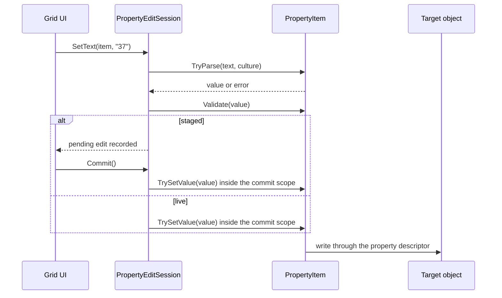

# PlexusAvaloniaPropertyGrid System Design

PlexusAvaloniaPropertyGrid is a generic, annotation-driven property grid for Avalonia in the style of the WinForms
property grid: it is given any annotated .NET object and shows and edits its properties honoring the
`System.ComponentModel` annotations. The system consists of UI-free layers (the property model, the property sources,
the edit session and the editor registry), the Avalonia controls built on them (the grid, its editors, the collection
editor and the property dialog) and an adapter layer that shows Plexus nodes, annotations and groups.

Scope: Generic, annotation-driven property grid for Avalonia: the UI-free layers and the Avalonia controls that show and
edit any annotated .NET object through System.ComponentModel annotations, type converters, edit sessions and a pluggable
editor registry.

## Architecture

The system consists of ten software units in the `DemaConsulting.Plexus.Avalonia.PropertyGrid` package. The generic
layers do not depend on Plexus types; the Plexus adapter (the `DemaConsulting.Plexus.Avalonia.PropertyGrid.Plexus`
namespace) is a separate layer that plugs in through the source abstraction and registers itself with the source factory
when the package loads.

- **PropertyModel** (unit, public) — `PropertyItem`, the view-model of one grid row: metadata (name, display name,
  category, description, type, read-only, browsable, password, parenthesized name, refresh mode, editor key), default
  and changed state, value access, text conversion and standard values through the type converter, the properties of
  expandable objects, collection elements, and validation. Failures are returned as `PropertyResult`. The
  descriptor-backed implementation of an item belongs to this unit.
- **PropertySources** (unit, public) — `IPropertySource` and its implementations: `ReflectionPropertySource` (any object,
  through `TypeDescriptor`), `CustomPropertySource` with `CustomPropertyItem` (host-supplied items without reflection),
  `CompositePropertySource` (merge), `PropertySourceFactory` (pick a source for an object, with registrable
  adapters), `IPropertyCommitScope` (a source that brackets the commits of its session) and `PropertyOrdering`
  (categorized and alphabetical order and grouping, with a category rank).
- **EditSession** (unit, public) — `PropertyEditSession` applies edits live or staged until commit, with per-property
  errors and a host commit scope (and the commit scope of its source, outermost);
  `PropertyCommitRefusedException` lets a scope refuse a commit because of one property; `CollectionEditor` edits
  collection properties through a working copy.
- **EditorRegistry** (unit, public) — `PropertyEditorAttribute` names a custom editor and
  `PropertyEditorRegistry<TEditor>` maps editor keys and property types to the editors of the UI layer.
- **PropertyGridControl** (unit, public) — the `PropertyGrid` control: two-column layout, categories, sorting, search,
  expansion, selection, description pane and keyboard handling over a source and an edit session.
- **PropertyEditors** (unit, public) — the editors of the value column (text, password, check box, drop-downs, flags,
  color, nested, collection), the `PropertyEditorContext` they use to read and write through the session, and the default
  editor registry; hosts register their own editors.
- **CollectionEditorUi** (unit, public) — `CollectionEditorView` (embeddable) and `CollectionEditorDialog`: a members list
  with Add, Remove and Move and a nested grid for the selected member, applying through the session on OK.
- **PropertyGridDialog** (unit, public) — a one-call modal dialog that edits an object in a staged grid.
- **PlexusNodeSource** (unit, public) — `NodePropertySource`, `AnnotationPropertySource` and `GroupPropertySource`: the
  sources that show a Plexus node (name, declared properties, host data on a working copy), annotation or group, each
  commit being one undo entry of the diagram; plus the registration with `PropertySourceFactory`.
- **NodePropertiesDialog** (unit, public) — a one-call modal dialog for a node: a `PropertyGridDialog` over a
  `NodePropertySource`.

Collaboration for one edit:

## External Interfaces

| Interface                          | Direction | Format                          | Constraints                  |
|------------------------------------|-----------|---------------------------------|------------------------------|
| `ReflectionPropertySource(object)` | In        | Annotated .NET object           | Not null                     |
| `IPropertySource`                  | In / Out  | Items, change notifications     | Changes on any thread        |
| `PropertyItem` members             | Out       | Metadata, values, text, results | `Try...` members never throw |
| `PropertyEditSession`              | In / Out  | Edits in; pending edits, errors | UI thread only               |
| Commit scope (`Action<Action>`)    | Out       | Host hook that runs the writes  | Runs the action exactly once |
| `PropertyEditorAttribute`          | In        | Annotation: editor key or type  | Key not empty                |
| `PropertyEditorRegistry<TEditor>`  | In / Out  | Editors by key or property type | Thread-safe                  |
| `PropertyGrid` control             | In / Out  | Object or source in; session    | UI thread only               |
| Editor factory                     | In        | Creates the editor control      | Writes through the context   |
| `CollectionEditorDialog` / view    | In / Out  | Session, collection item; list  | UI thread only               |
| `PropertyGridDialog.ShowAsync`     | In / Out  | Owner, object, title, scope     | UI thread only               |
| `NodePropertySource(Node)`         | In / Out  | Node; rows, commits, changes    | Node attached; UI thread     |
| `NodePropertiesDialog.ShowAsync`   | In / Out  | Owner, node; true on OK         | UI thread only               |
| `IPropertyCommitScope.RunCommit`   | Out       | Source hook around each commit  | Runs the action exactly once |

Errors from user code (accessors, converters, validation attributes) are reported as `PropertyResult` values, never as
exceptions. Argument errors (null arguments) are reported as `ArgumentNullException` or `ArgumentException`.

## Dependencies

- **Avalonia** (OTS) — the controls (grid, editors, collection editor, dialogs) are Avalonia controls that take their
  colors from the Fluent theme resources; the UI-free layers use only the .NET base class library. The controls are
  tested on the headless Avalonia host (Skia drawing). See _Avalonia_ in the OTS design documents.

- **DemaConsulting.Plexus** (the core package) — used only by the Plexus adapter layer (nodes, the property bag, the rename
  pipeline, `UndoHistory.Transact`, `Node.CloneData`). The generic layers use no Plexus type (verified by a system
  test); the package has no dependency on the Rendering or Avalonia editor packages.

## Risk Control Measures

N/A - the property grid performs no safety-related function. The only integrity measures are that user-supplied code
(property accessors, type converters, validation attributes, the host commit scope, element factories) is called inside
guarded sections so that its exceptions become error messages, and that a staged session never touches the target until
the user commits.

## Data Flow

1. A host gives the grid an object; `PropertySourceFactory` (or the host) creates an `IPropertySource`, by default a
   `ReflectionPropertySource` that reads `TypeDescriptor.GetProperties`.
2. The grid asks the source for its items and `PropertyOrdering` orders and groups them. Each row shows the item's
   label, its text (`GetText`, current culture), a bold style when `IsChanged`, and the editor chosen by
   `PropertyEditorRegistry` from the item's editor key, type and standard values.
3. The user edits. The UI calls `PropertyEditSession.SetText` or `SetValue`. In live mode the item is written at once; in
   staged mode a pending edit is recorded and shown instead of the target value. Errors are recorded per property path.
4. Collection properties are edited with a `CollectionEditor` working copy. In staged mode it is one pending edit.
5. `Commit` applies the pending edits in order inside the host's commit scope (for example an undo transaction); failed
   edits stay pending with their error. `Cancel` discards them.
6. A change of the target (`INotifyPropertyChanged`) or of a property annotated to refresh everything tells the grid to
   re-read values.
7. The grid (`PropertyGrid`) performs steps 1 to 6 for its user: it creates the source and the session, builds one row per
   category band or item (reusing the row views of unchanged rows), creates the editor of each row from the editor
   registry, and refreshes the rows on every session or source change. A collection row opens the collection editor,
   which edits a working list and applies it to the session on OK; `PropertyGridDialog` wraps a staged grid with OK
   (commit) and Cancel (discard).
8. A Plexus element given to the grid is turned into a `NodePropertySource` (or the annotation or group source) by the
   registered factory. Its items read the element until the grid writes: a write goes to a working value (the name, a
   property) or to a working copy of the host data (`Node.CloneData`). The session runs each commit inside the source's
   `RunCommit`, which opens one undo transaction, lets the session write, and then publishes the working state: the
   rename through the rename pipeline, the changed properties with `PropertyBag.TrySetAll`, and the data copy when its
   JSON differs from the live data. A refusal (a vetoed rename) rolls the transaction back and marks the name row. The
   live data object is never mutated.

## Design Constraints

- Targets .NET 10 and is tested on Windows, Linux and macOS.
- The generic layers must not reference Plexus types; the Plexus adapter is a separate layer built on `IPropertySource`
  and `IPropertyCommitScope`.
- Every commit through a Plexus source is exactly one undo entry; hosts do not supply a commit scope for it.
- Attribute fidelity with the WinForms property grid is a goal: the same annotations produce the same presentation. The
  WinForms `UITypeEditor` mechanism is deliberately not supported because it depends on Windows Forms services;
  `PropertyEditorAttribute` replaces it.
- Text conversion uses the current culture unless the caller passes a culture; persisted text should use the invariant
  culture explicitly.
- Sessions, items and editors are not thread-safe; use them from the UI thread. The editor registry and the source
  factory are thread-safe.
- Rows are 22 pixels high with flat editors; colors come from theme resources, never fixed colors, except the validation
  red that works on both variants.
- Edits made to the properties of the member objects of a collection are made on the objects (as in the WinForms
  collection editor) and are not undone by Cancel; only the list is.
- The Avalonia headless test adapter for xUnit v3 is not used (it is incompatible with the xUnit version in use); the
  tests drive the UI thread through the Avalonia headless platform with a small helper.

## Known Limitations and Future Considerations

- **Headless test attribute.** The tests should switch to the Avalonia headless xUnit attribute (`[AvaloniaFact]`) once
  an adapter release supports the xUnit v3 generation used by the repository.
