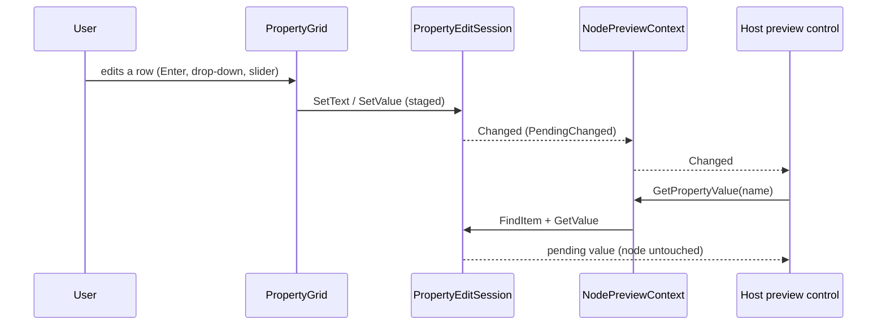

## NodePropertiesDialog Unit Design

Scope: The `NodePropertiesDialog` helper: the ready-made modal properties dialog of a Plexus node, its options
(`NodePropertiesDialogOptions`, `NodePreviewPlacement`) and the read-only preview context (`NodePreviewContext`) that
turns the dialog into a custom node inspector.

### Purpose

A host that shows a `DiagramEditor` wants one line to edit a node on double-click:
`editor.NodeDoubleClicked += async (_, e) => await NodePropertiesDialog.ShowAsync(this, e.Node);`. The dialog is a
`PropertyGridDialog` (a staged grid with OK and Cancel) over the node's `NodePropertySource`, so OK applies the rename,
the changed properties and the edited host data as one undo entry and Cancel changes nothing.

Hosts that migrate custom node inspectors (for example a configuration designer coming from WinForms) also want a
visualization of what the settings do, next to the grid, that redraws while the user edits and before OK. The optional
preview provides that pattern without rebuilding staging, validation or undo: the host supplies a factory that receives
a `NodePreviewContext` and returns a control. The context only reads, so OK and Cancel keep their meaning. Hosts that
build their own window create the same context over their own staged grid or session.

### Data Model

- `NodePropertiesDialog` has no state of its own: a static class that creates a `PropertyGridDialog` titled
  "<name> - Properties" (480 by 640 device-independent pixels) for the node.
- `NodePropertiesDialogOptions` is an immutable record: `Preview` (the factory, `Func<NodePreviewContext, Control>`, null
  for the plain dialog), `PreviewPlacement` (`Side`, the default, or `Top`), `Title` (null for the default title) and
  `Width` and `Height` (null for the defaults: 880 by 640 with a side preview, 480 by 860 with a top preview, 480 by 640
  without a preview). A side preview is 400 pixels wide and a top preview 220 pixels high.
- `NodePreviewContext` holds the grid it follows (or none, for a context over a fixed session), the node that was shown
  when it was created, the current session (subscribed to its `Changed` event) and a disposed flag.

### Key Methods

- **`ShowAsync(owner, node)`** — shows the dialog modally; the task completes with true after a successful OK and false
  after Cancel.
- **`ShowAsync(owner, node, options)`** and **`Create(node, options)`** — the same with the options. With a preview,
  `Create` builds the dialog, creates a `NodePreviewContext` over the dialog's grid, calls the factory once, passes the
  control to the dialog's internal `SetPreview` hook (docked right or top, automation id `PropertyGridDialog_Preview`) and
  disposes the context when the window closes. Without a preview the result is the plain dialog with the title and
  size applied.
- **`Create(node)`** — the window without showing it. **`GetTitle(node)`** — the title.
- **`NodePreviewContext.GetValue(path)`** — the effective value of a row: `session.FindItem(path)` followed by
  `session.GetValue(item)`, which returns the pending value (the default for a pending reset, the working list for a
  collection edit) or else the node's current value; null for an unknown path. **`GetPropertyValue(name)`** reads the
  row `Property.<name>`.
- **`NodePreviewContext.Changed`** — raised for the session kinds `PendingChanged`, `Cancelled`, `Committed` and
  `Applied`, and when the grid replaces its session (the context follows `PropertyGrid.SessionProperty`); not raised for
  `ErrorChanged`, which changes no value. Text editors stage on Enter or lost focus, so the preview redraws when a field
  is committed rather than on every keystroke.
- **`NodePreviewContext.Dispose`** — unsubscribes from the grid and the session; reads keep working on the last session.

The notification path from an edit to a redraw:

### Error Handling

A null owner or node raises `ArgumentNullException`; a node that is not attached to a diagram raises `ArgumentException`.
A `Width` or `Height` that is not a positive finite number raises `ArgumentOutOfRangeException` before any window is
built, and a factory that returns null raises `InvalidOperationException`. When the factory throws, the context is
disposed and the exception propagates. The context rejects a null grid, session, path or property name
(`ArgumentNullException`) and a grid or session that does not show a node (`ArgumentException`). An invalid or vetoed name
keeps the dialog open with the reason (see the PropertyGridDialog unit).

### Dependencies

The PropertyGridDialog unit (the dialog and its internal `SetPreview` hook), the PropertyGridControl unit
(`PropertyGrid.Session` and `SessionProperty`, followed by the context), the EditSession unit (`FindItem`, `GetValue` and
`Changed`) and the PlexusNodeSource unit (the row paths and the node); Avalonia (OTS) windows and controls.

### Callers

Host applications that edit nodes, and host-built inspector windows that use `NodePreviewContext` directly.
