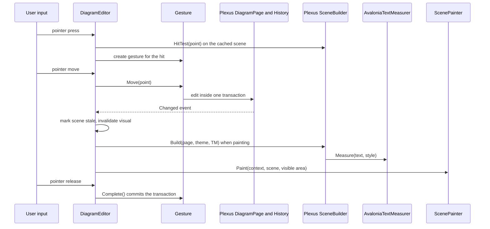

# PlexusAvalonia System Design

PlexusAvalonia is the `DemaConsulting.Plexus.Avalonia` package: an Avalonia control, `DiagramEditor`, that shows one
page of a Plexus diagram and lets the user edit it with pointer and keyboard. It builds on the Plexus core system for
the model, the undo history and the painter-agnostic scene, and adds only what is specific to a desktop UI: drawing
onto an Avalonia drawing context, input handling, inline editors, the operating-system clipboard and drag-and-drop.

Scope: Avalonia editor control that shows one diagram page at a time with pointer and keyboard editing, inline rename,
host events and an operating-system clipboard bridge.

## Architecture

The system consists of one subsystem and three units in the `DemaConsulting.Plexus.Avalonia` package, plus the
dependencies on the Plexus core system, Avalonia and Svg.Controls.Skia.Avalonia:

- **Editor** (subsystem) — the interactive control and its helpers:
  - **DiagramEditor** (unit, public) — the control. It owns the view state (zoom, offset, selection, hover), builds and
    caches the scene, routes pointer and keyboard input, runs the inline rename and annotation editors, offers the
    history, delete, duplicate and clipboard commands, and raises the events used by the host.
  - **Gestures** (unit, internal) — one state machine per pointer interaction (move or duplicate, connect, annotation
    resize, wire segment, bend and end drag, pan and rubber band). A gesture edits the model inside a single history
    transaction so
    that a whole drag is one undo step and can be rolled back.
  - **DiagramClipboard** (unit) — the clipboard abstraction (`IDiagramClipboard`, public), its operating-system
    implementation, and the text formatting helper shared by painting and measuring.
  - **NodeTypeDragSource** (unit, internal) — makes a palette control start a drag of a node type.
  - **NodePalette** (unit, public) — a palette control that lists node types, each drawn exactly as a new node looks on
    the canvas (same scene builder, painter, theme and zoom), with a search box, category groups, selection, activation
    and drag; given an editor it follows the editor's diagram and theme and adds nodes on activation; the editor's drop
    ghost is drawn from the same prototypes.
- **ScenePainter** (unit, internal) — paints scene primitives (rectangles, paths, text, icons and the grid) onto an
  Avalonia drawing context and caches brushes, pens, geometries and formatted text. The value conversions between
  Plexus and Avalonia types belong to this unit; they are the public `PlexusAvaloniaExtensions` methods
  `ToAvalonia()` and `ToPlexus()` for points, sizes, rectangles and colors, which hosts use at the same boundary.
- **AvaloniaTextMeasurer** (unit, public) — implements the core text-measurement interface with Avalonia text
  formatting, so that the layout computed by the core scene builder matches the glyphs that are drawn.
- **PlexusIcons** (unit, public) — converts host SVG icons to cached Avalonia images and tolerates malformed SVG.

Collaboration while the user edits a page:

The control never edits anything except through the core model API, so every edit is undoable and raises the
diagram's change event, which is also how the control learns about changes made by anything else. The control owns
only view state.

## External Interfaces

| Interface                         | Dir.     | Format                             | Constraints                 |
|-----------------------------------|----------|------------------------------------|-----------------------------|
| `DiagramEditor` properties        | In / Out | Avalonia styled properties         | UI thread only              |
| `DiagramEditor` commands          | In       | Public methods                     | UI thread only              |
| `DiagramEditor` events            | Out      | .NET events with argument classes  | Raised on the UI thread     |
| Pointer, wheel and keyboard input | In       | Avalonia routed input events       | Control must be focusable   |
| `IDiagramClipboard`               | In / Out | Text (Plexus clipboard JSON)       | Host may substitute its own |
| Operating-system clipboard        | In / Out | Plexus format and plain text       | Failures reported as events |
| Node type drag payload            | In       | Node type key (application format) | Unknown keys ignored        |
| `NodeTypeDragSource` helper       | In       | A control and a node type key      | Detach by disposing         |
| `NodePalette` properties, event   | In / Out | Avalonia styled properties, event  | UI thread only              |
| `AvaloniaTextMeasurer`            | Out      | Core `ITextMeasurer`               | UI thread only              |
| `PlexusIcons.GetImage`            | Out      | Avalonia image, or null if broken  | Thread-safe cache           |
| `PlexusAvaloniaExtensions`        | Out      | Avalonia point, size, rect, color  | Pure, lossless conversions  |
| Automation                        | Out      | Avalonia automation peer (pane)    | Default id `DiagramEditor`  |

The properties are the page, theme, zoom, offset, grid, snapping, read-only mode and clipboard. The commands are
selection, delete, duplicate, undo, redo, copy, cut, paste, rename, annotation edit, zoom and hit testing.

The events are: `SelectionChanged`, `NodeDoubleClicked`, `DiagramContextRequested`, `PasteFailed` and
`ClipboardFailed`. Argument errors are reported as `ArgumentNullException`; invalid user actions (rejected names,
rejected connections, unusable clipboard content) are not exceptions but are reported through state, return values or
events.

## Dependencies

- **Plexus core system** — page model and its edit API, the undo history and its transactions, the scene builder and
  hit testing, the connection rules, the clipboard serialization, the rename pipeline, the theme and the
  text-measurement interface. See _Plexus System Design_.
- **Avalonia** (OTS) — control base classes, drawing context, input, text formatting, drag-and-drop, clipboard,
  automation and, for tests, the headless platform. See _Avalonia_ in the OTS design documents.
- **Svg.Controls.Skia.Avalonia** (OTS) — conversion of SVG text to drawable images. See _SvgSkia_ in the OTS design
  documents.

The package does not depend on the rendering package.

## Risk Control Measures

N/A - the editor performs no safety-related function. The integrity measures are containment measures: clipboard
content is treated as untrusted and a bad paste changes nothing and is reported through an event; platform failures of
the clipboard or of drag-and-drop never propagate out of the control; a malformed icon is shown as missing; and a
gesture or inline edit that is abandoned (Escape, Undo, Redo, page change, read-only) is rolled back so a half-made
change never reaches the history.

## Data Flow

1. The host assigns a `DiagramPage` (and optionally a theme, zoom, offset and options) to the control.
2. When the control needs to paint or hit test it asks for the scene: the core scene builder is given the page, the
   theme, an `AvaloniaTextMeasurer`, the selection, the hover element and the area around the visible region, and
   returns an immutable scene. The scene is cached until the model changes, the selection or hover changes, or the
   view leaves the area the scene was built for; any number of changes before the next frame cost one rebuild.
3. `ScenePainter` draws the primitives that intersect the visible area onto the drawing context, which carries the
   view transform (translation by the offset and scale by the zoom). Icons come from `PlexusIcons`.
4. User input is first checked for the inline editors, then mapped by hit testing the scene to a gesture, a selection
   change, an inline editor, a host event or a command.
5. A gesture or command edits the model through the core API; the model raises its change event, which invalidates the
   scene and, for removals, prunes the selection and abandons inline edits of removed elements.
6. Copy writes the selection as Plexus clipboard JSON through the clipboard (Plexus format and plain text); paste reads
   it, lets the core validate and import it as one undo step, and selects the result or raises `PasteFailed`.
7. A dropped node type payload creates a node at the drop point as one undo step.

## Design Constraints

- Targets .NET 10 and is tested on Windows, Linux and macOS; the control is used on the Avalonia UI thread only, like
  the model it shows.
- The control must work with zero configuration: a bound page is displayed with the diagram's own theme and is
  editable.
- Painting and hit testing must read the same scene so that what the user clicks is what is drawn.
- Scenes are built only for the visible area plus half a screen on each side, so that large diagrams stay
  responsive while panning.
- The editor opens no dialogs or menus; hosts react to events.
- Tests run on the Avalonia headless platform with Skia drawing. The Avalonia headless test adapter for xUnit v3 is not
  used (it is incompatible with the xUnit version in use); the tests start one headless session for the whole run and
  dispatch every test body to its UI thread through a small helper.

## Key Design Decisions

- **The editor shows one page at a time and the host owns the surroundings.** Page tabs, menus, file handling and
  property editing are host concerns because they differ in every application; the control exposes the page, events
  (double-click and right-click on nodes, wires and the canvas, selection, paste and clipboard failures) and commands.
  The ready-made property dialog and panel are the separate PlexusAvaloniaPropertyGrid system.
- **Inline title rename is built in, validated by a host hook.** Renaming a node title is the most common edit, so the
  editor provides it. The core rename pipeline lets the host accept, correct or reject the new name, and the result is
  one undoable command, so a refused name never reaches the model.
- **Undo and Redo during a gesture only cancel it.** While a drag or an inline edit is in flight, Undo or Redo
  abandons the gesture and rolls back its transaction; only a second press changes the history. A half-made change
  therefore never becomes a history entry and the user cannot undo an earlier step by accident while still dragging.
- **Tooltips through Avalonia's tooltip service; the host decides the text.** The editor sets its own `ToolTip.Tip`
  for the element under the pointer instead of drawing tooltips itself, so delay, placement and look match the rest of
  the host application. The default text comes from the node type and port declarations, and the `ToolTipRequested`
  event lets the host replace it (live values, validation messages) or suppress it; `ShowToolTips` turns the feature
  off for hosts that manage the editor's tooltip themselves.
- **Navigation switches pages and respects the user's zoom.** `BringIntoView` changes the shown page when needed and
  only scrolls (zooming out only when the element does not fit), and a set of elements is fitted like the whole page
  (never magnified above actual size, first element's page when they span pages). Requests made before the first layout
  wait for it, and the latest request of any kind wins, so a window constructor can navigate safely.
- **Native vector icons and a close visual match.** Host SVG icons are drawn through Svg.Controls.Skia.Avalonia as
  vector graphics rather than bitmaps, so they stay sharp at any zoom. The editor and the headless renderer share the
  scene, layout and hit-test geometry, and differ only in drawing: their text engines and SVG renderers are
  different libraries, so the images are visually equivalent ("close enough to look the same") but not pixel-identical.

## Known Limitations and Future Considerations

- **No connections to proxy ports.** A wire cannot be started from, or dropped onto, the read-only proxy ports of a
  collapsed group; the user expands the group first.
- **SVG subset parity.** Icons render through a different SVG engine than in PlexusRendering, so an icon that uses
  features outside the subset both engines support can look different or be missing in one of them; a malformed icon is
  shown as missing. Hosts should keep icons within the common subset (see _SvgSkia_ in the OTS design documents).
- **Headless test attribute.** The editor tests use a small helper instead of the Avalonia headless xUnit attribute
  (`[AvaloniaFact]`), because the adapter does not yet support the xUnit v3 generation used by the repository. The tests
  should switch to the attribute once an adapter release supports it.
- **Windows-only automation tooling.** The demo applications that exercise the editor against the real operating
  system are driven by a Windows-only tool (see _Introduction_); the control itself is tested on all three platforms.
