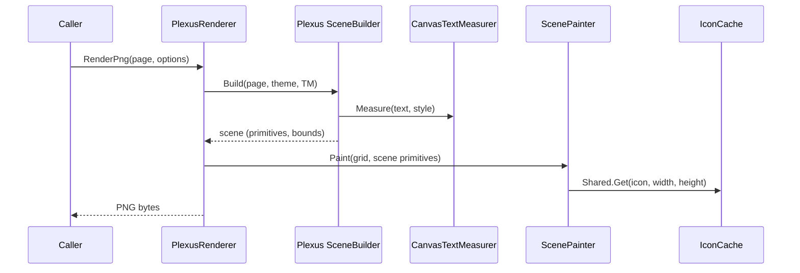

# PlexusRendering System Design

PlexusRendering turns one page of a Plexus diagram into a PNG image without any UI framework. It reuses the core
library to build a painter-agnostic scene and paints that scene's primitives with CanvasNet.

Scope: Headless renderer that paints a Plexus scene for one page to a PNG image using CanvasNet.

## Architecture

The system consists of four software units in the `DemaConsulting.Plexus.Rendering` package, plus the dependency on
the Plexus core system and the CanvasNet OTS item:

- **PlexusRenderer** (unit, public) — the entry point. It validates the render options, asks the core scene builder
  for a scene, works out the image area and size, creates the pixel surface, paints background, grid and scene, and
  encodes PNG. Its options class `RenderOptions` is part of this unit.
- **ScenePainter** (unit, internal) — paints the scene primitives (rectangles, paths, text, icons, grids) onto a
  surface with a fixed origin and scale.
- **CanvasTextMeasurer** (unit, public) — implements the core text-measurement interface with CanvasNet fonts, so
  that layout computed by the scene builder matches the pixels the painter draws. The internal font lookup used by
  both the measurer and the painter belongs to this unit.
- **IconCache** (unit, internal) — rasterizes node icons from SVG once per pixel size and shares the result; a shared
  instance holds at most 512 rasterizations and is emptied when it is full.

Collaboration for one render:

## External Interfaces

| Interface                     | Direction | Format                            | Constraints                          |
|-------------------------------|-----------|-----------------------------------|--------------------------------------|
| `PlexusRenderer.RenderPng`    | Out       | PNG file contents (byte array)    | Opaque backgrounds have no alpha     |
| `PlexusRenderer.SavePng`      | Out       | PNG file at a caller path         | Replaces a file; folder must exist   |
| `PlexusRenderer.Render`       | Out       | CanvasNet surface, straight alpha | Caller owns and disposes it          |
| `RenderOptions`               | In        | Immutable options object          | Usable values; selection copied      |
| `CanvasTextMeasurer`          | Out       | Core `ITextMeasurer`              | Thread-safe                          |
| `DiagramPage`, `DiagramTheme` | In        | Core model types                  | DiagramPage not modified by a render |

`RenderOptions.Theme` changes the look only: the geometry of ports, port triangles and wire ends always follows the
diagram's own theme, so wires stay attached to their ports; port metrics are set on the diagram's theme.

Exception policy (the library translates no exception):

- Argument problems (a null page, an unusable scale, padding, bounds or path, an image beyond the maximum size) are
  reported as `ArgumentNullException` or `ArgumentException`, before any surface is allocated.
- `SavePng` renders the PNG completely before it opens the file, then writes it; file-system exceptions of the write
  (`IOException` including `DirectoryNotFoundException` and `PathTooLongException`, `UnauthorizedAccessException`,
  `NotSupportedException`, `SecurityException`) propagate unchanged, so a failed save never leaves a truncated file
  behind for an invalid argument or a rendering failure.
- Exceptions raised by CanvasNet while painting or encoding propagate unchanged after the surface has been disposed.
- Icon rasterization failures are contained: the icon is skipped and the rest of the page is rendered.

## Dependencies

- **Plexus core system** — page model, scene builder, scene primitives, theme and the text-measurement interface.
  See _Plexus System Design_.
- **CanvasNet** (OTS) — canvas drawing, fonts, SVG rasterization and PNG encoding. See _CanvasNet_ in the OTS
  design documents.

The package has no dependency on Avalonia or on any other UI framework.

## Risk Control Measures

N/A - the renderer performs no safety-related function. The only integrity measures are input validation (the image
size is limited to the maximum CanvasNet surface size, so an absurd scale or bounds request fails with an exception
rather than exhausting memory) and containment of icon failures (a malformed icon is skipped instead of failing the
whole render).

## Data Flow

1. The caller supplies a page and optional render options.
2. `PlexusRenderer` validates the options and chooses the theme (the options' theme or the diagram's).
3. The core scene builder, given a `CanvasTextMeasurer`, produces the scene primitives and their bounds, without a
   grid. Each node is drawn with its current ports, including ports a port provider computed for it, because the scene
   is built from the model as it is.
4. The renderer takes the requested bounds, or the scene bounds inflated by the padding, as the image area. The
   area's origin is floored to a whole unit so integer diagram coordinates land on pixel edges, and the pixel size is
   the area size times the scale, rounded up.
5. The renderer creates a surface, fills it with the background, paints the grid (if enabled) and then the scene
   primitives in z-order through `ScenePainter`, which obtains rasterized icons from the shared `IconCache`.
6. `RenderPng` and `SavePng` encode the surface as PNG (RGB for opaque backgrounds, RGBA otherwise); `Render`
   returns the surface itself.

## Design Constraints

- Targets .NET 10 and is tested on Windows, Linux and macOS.
- The package must stay headless: no reference to any UI framework (verified by a system test).
- Text is measured and painted through the same font lookup, which prefers an installed font of the theme's family
  and falls back to the bundled Liberation Sans; output therefore differs slightly between machines with and without
  the family installed, but layout always matches the pixels on the same machine.
- All shared state (font cache, icon cache) is thread-safe, and options are immutable, so concurrent renders of an
  unmodified page are supported. A `ScenePainter` instance is bound to one surface and is not shared.
- The maximum image dimension is the CanvasNet surface limit.

## Key Design Decisions

- **A separate headless package on CanvasNet.** Rendering is its own package, and the editor package does not reference
  it, so that servers, build pipelines, tests and agent tooling can produce images without any UI framework, and an
  editor-only application does not carry a drawing library it does not use. CanvasNet was chosen because it is a pure
  managed, display-independent canvas (see _CanvasNet_ in the OTS design documents).
- **The scene is the contract, not the pixels.** The renderer paints the same scene, layout and hit-test geometry as
  the editor and adds no layout of its own, which keeps the two painters consistent. Parity is visual, not
  pixel-identical, because the text engines and SVG renderers differ.
- **Icons through CanvasNet.Svg.** Host SVG icons are rasterized once per pixel size and cached; an icon that fails to
  load is skipped rather than failing the render.
- **No dedicated OTS test project for CanvasNet.** The renderer's own unit tests inspect rendered pixels, measured text
  and PNG output, so they prove the CanvasNet behavior Plexus relies on (see the CanvasNet OTS verification).

## Known Limitations and Future Considerations

- **SVG subset parity.** CanvasNet.Svg and the editor's SVG library support overlapping but different parts of SVG;
  icons should stay within the common subset so both painters look alike.
- **Fonts differ between machines.** Output differs slightly between machines with and without the theme's font family
  installed (see _Design Constraints_); layout always matches the pixels on one machine, but stored reference images
  should be compared with a tolerance or on a controlled font set.
- **Single target framework.** The package targets one framework although CanvasNet supports the framework range of the
  core. Whether it should multi-target like the core is an open question that depends on consumer demand.
