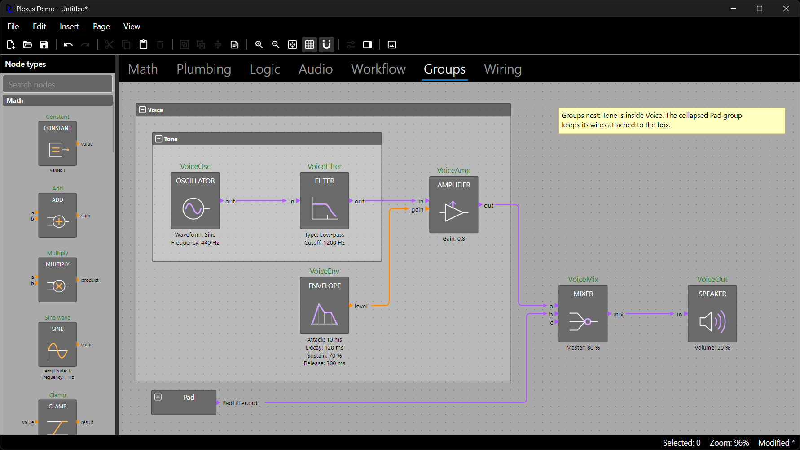
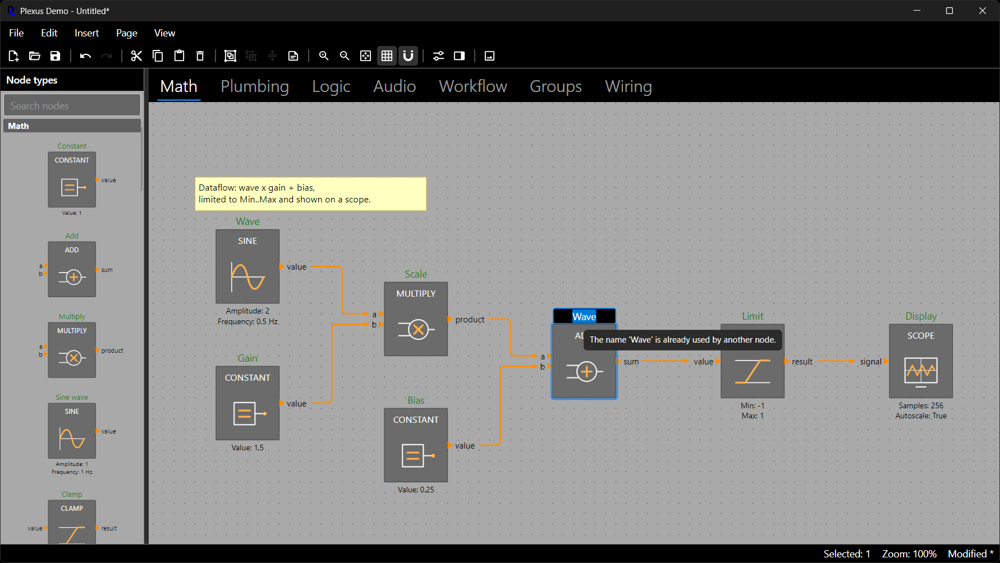

# Building and Editing Diagrams

Everything an editor does to a diagram is available in code, through the same methods, so scripts, importers and tests
build diagrams exactly like users do. Every call below is validated, routed where it affects wires, undoable and
raises `Diagram.Changed`. The fragments continue from the diagram of *Getting Started*.

## Pages

A diagram has an ordered list of pages; a page is one canvas.

```csharp
var details = diagram.Pages.Add("Details");     // append a page
var overview = diagram.Pages.Insert(0, "Overview");
diagram.Pages.Move(details, 1);                 // reorder
details.Name = "Details 2";                     // rename (undoable)
diagram.Pages.Remove(overview);                 // removes the page and its content (undoable)
```

`diagram.Pages` implements `INotifyCollectionChanged`, so a tab strip or list bound to it stays in step. Wires never
cross pages; moving elements between pages is described below.

## Nodes

Nodes are created from a type key at a position. Names are generated when omitted (`Add1`, `Add2`, ...); names are
unique across the whole diagram by default (`diagram.RequireUniqueNodeNames`).

```csharp
var extra = page.AddNode("math.Add", 240, 225);              // generated name
var total = page.AddNode("math.Add", 240, 300, "Total");     // explicit name
total.MoveTo(300, 300);                                      // or page.Move([total], 60, 0)
total.Name = "Subtotal";                                     // goes through the rename pipeline, see below
page.Remove(extra);                                          // removes the node and its wires
```

`node.Bounds` is the box of the node in diagram units; the node size comes from `NodeType.DefaultSize` or the theme.
`node.Type` is the node type, `node.Inputs` and `node.Outputs` list the ports, and `node.Wires` lists the connected
wires.

## Connecting Ports

A wire runs from an output port to an input port. Name the ports as `"Node.port"`, or use the port objects:

```csharp
var c = page.AddNode("math.Constant", 30, 270, "C");
var wire = page.Connect("C.value", "Scope.signal");          // paths; the wire is routed automatically
var other = b.Port("value").ConnectTo(sum.Port("b"));        // or with the port objects
```

A connection is validated against the structural rules (output to input, same page, different nodes, no duplicate
wire) and the diagram's connection rules (see *Wires, Routing and Connection Rules*). `Connect` throws
`InvalidOperationException` with the reason; to ask first, use `CanConnect`, which is what the editor does while the user
drags a wire:

```csharp
ConnectionCheck check = page.CanConnect(b.Output("value"), sum.Input("b"));
if (!check.IsAllowed)
{
    ShowMessage(check.Reason!);     // for example: Input 'Sum.b' already has a wire; it does not accept more than one.
}
```

## Annotations

An annotation is a free text note with a resizable box; its text is edited in place in the editor.

```csharp
var note = page.AddAnnotation("Check the scale", new Rect(30, 330, 160, 50));
note.Text = "Scale checked";                // undoable
note.Fill = Color.Parse("#FFE0A0");         // null means the theme's annotation fill
```

## Groups

A group frames its members, moves them together, nests, and can be collapsed into one summary box. Members are nodes,
annotations and other groups.

```csharp
var inputs = page.CreateGroup([a, b], "Inputs");              // frames the members with a titled box
var adder = page.CreateGroup([inputs, sum], "Adder");         // groups nest
inputs.IsCollapsed = true;                                    // one box; wires stay attached to it
inputs.Title = "Sources";                                     // undoable
page.Ungroup(adder);                                          // dissolves the frame, keeps the members
```

A collapsed group shows a *proxy port* for each member port that has a wire leaving the group, so the diagram still
reads as connected; the wires keep their identity and are drawn to the collapsed box. Removing a group with
`page.Remove(group)` removes only the frame; `page.RemoveWithMembers(group)` removes the members as well. Every element
has a `Parent` (the group it is in, or `null`) and `IsVisible` (false inside a collapsed group).



## Moving and Removing

```csharp
page.Move([a, b, note], 30, 0);      // by a delta; groups bring their members, wires follow
page.Remove([note, c]);              // several elements, one undo entry
```

Moving elements by the same delta translates the route of a wire between them. A wire with only one moved end is
routed again, which discards manual edits of its route. `page.RerouteAll()` routes every wire of the page again, and
`wire.Reroute()` one wire. Wires avoid the frames of groups they do not belong to, but only when they are routed, so
after moving a group call `RerouteAll()` if unrelated wires should avoid its new position.

## Moving Elements to Another Page

```csharp
var detailsPage = diagram.Pages[1];
diagram.MoveToPage([c, note], detailsPage);       // one undo entry
```

Wires among the moved nodes come along; wires to nodes left behind are removed. The editor's selection is a view
concern: elements moved to another page leave it. The editor's `MoveSelectionToPage(target)` moves the selection for you
(see *The Avalonia Editor*); a host that moves a selection itself takes a copy first:
`diagram.MoveToPage(editor.Selection.ToArray(), target)`. The demo's *Page > Move Selection To* menu and the context
menu entry *Move To Page* call the editor's command.

## Finding Things

```csharp
Node? node = diagram.FindNode("Sum");                 // by name, on any page
Port? port = diagram.FindPort("Sum.a");               // by path
DiagramElement? element = diagram.FindElement(wire.Id);
int nodeCount = page.Nodes.Count;                     // page.Nodes, Wires, Annotations, Groups: observable lists
```

`page.Elements` lists everything in z-order (the first is the bottom-most). The lists are `ReadOnlyObservableCollection`s,
so a host UI can bind to them directly.

## Listening to Changes

`Diagram.Changed` is raised for every applied change, including undo and redo themselves. Painters and controls
invalidate on it; hosts use it to keep their own views in step.

```csharp
diagram.Changed += (_, e) =>
{
    // e.Kind: ElementAdded, ElementRemoved, ElementChanged, PageAdded, PageRemoved, PageMoved, PageRenamed, SettingsChanged
    ShowMessage($"{e.Kind}: {e.Element?.Id ?? e.Page?.Name} {e.PropertyName}");
};
```

`diagram.Version` is a number that increases with every change (undo, redo and `RefreshAppearance()` included). It is a
cheap cache key for anything computed from the diagram: remember the version next to the value and recompute when it
differs. Individual elements and pages also raise `PropertyChanged` for their own members.

## Renaming Nodes

Renaming a node, whether in code or in place in the editor, raises `Diagram.NodeRenaming` first, so the host can
correct or reject the new name. The result is one undo entry.

```csharp
diagram.NodeRenaming += (_, e) =>
{
    if (e.ProposedName.Contains(' '))
    {
        e.NewName = e.ProposedName.Replace(' ', '_');   // correct the proposal
    }
    else if (e.ProposedName.Length > 32)
    {
        e.Cancel = true;                                // or reject it
        e.Reason = "Names are limited to 32 characters.";
    }
};

bool renamed = diagram.TryRename(sum, "Main sum", out string? reason);    // reason says why when it fails
```

`node.Name = "x"` and `diagram.Rename(node, "x")` throw when the name is refused. The proposal is trimmed and checked
for being non-empty and (by default) unique before the event is raised, and a corrected name is checked again.
`Diagram.NodeRenamed` is raised after a rename was applied, including by undo and redo. The editor's inline rename uses
the same pipeline and shows the reason as a tooltip while the user keeps editing.


