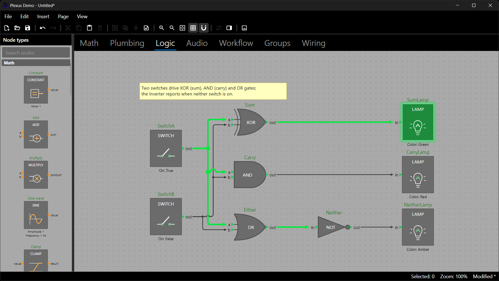
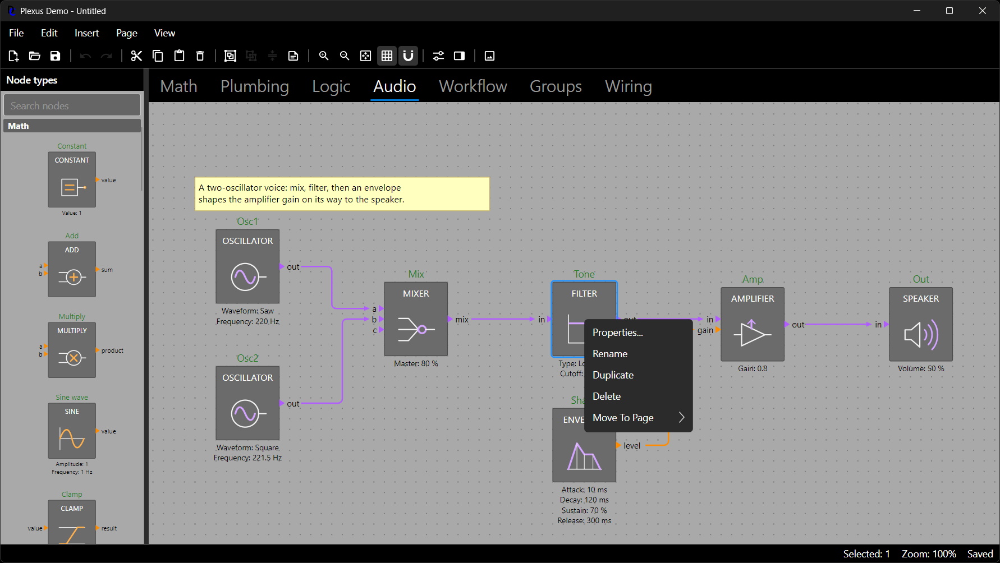

# The Avalonia Editor

`DemaConsulting.Plexus.Avalonia` provides `DiagramEditor`, a control that shows one page of a diagram and lets the user
select, move, connect, rename, group, copy and delete, with full undo and redo. The editor owns only view state (zoom,
offset, selection, hover); every edit goes through the model API of the earlier chapters, so the editor and your code
stay in sync through `Diagram.Changed`. It opens no dialogs and no menus: it raises events and the host decides what
happens. Page tabs, menus and file handling belong to the host; the properties dialog and panel come ready-made in the
separate property grid package (see *The Property Grid*).



## A First Application

A window with a node palette, page tabs and the editor is mostly declarative. The palette follows the editor, so it
needs only a reference to it, and a two-way binding keeps the tab strip and the editor's page in step (the editor
switches pages by itself when the page it shows is removed, for example by undo).

```xml
<!-- File: MainWindow.axaml -->
<Window xmlns="https://github.com/avaloniaui"
        xmlns:x="http://schemas.microsoft.com/winfx/2006/xaml"
        xmlns:plexus="https://github.com/demaconsulting/plexus"
        xmlns:core="clr-namespace:DemaConsulting.Plexus;assembly=DemaConsulting.Plexus"
        x:Class="MyApp.MainWindow" Title="Math" Width="1000" Height="650">
  <DockPanel>
    <StackPanel DockPanel.Dock="Top" Orientation="Horizontal" Spacing="6" Margin="6">
      <Button Content="Open..." Click="OnOpen" />
      <Button Content="Save..." Click="OnSave" />
    </StackPanel>
    <Grid ColumnDefinitions="220,5,*">
      <plexus:NodePalette Editor="{Binding #Editor}" />
      <GridSplitter Grid.Column="1" ResizeDirection="Columns" />
      <DockPanel Grid.Column="2">
        <TabStrip x:Name="Tabs" DockPanel.Dock="Top" SelectedItem="{Binding #Editor.Page, Mode=TwoWay}">
          <TabStrip.ItemTemplate>
            <DataTemplate x:DataType="core:DiagramPage">
              <TextBlock Text="{Binding Name}" />
            </DataTemplate>
          </TabStrip.ItemTemplate>
        </TabStrip>
        <plexus:DiagramEditor x:Name="Editor" ShowGrid="True" SnapToGrid="True" />
      </DockPanel>
    </Grid>
  </DockPanel>
</Window>
```

The code-behind creates a diagram, hands its pages to the tabs and shows the first page. Opening and saving use the
window's storage provider and the stream forms of `ToJson` and `FromJson` of *Saving, Loading and the Clipboard*:

```csharp
// File: MainWindow.axaml.cs
using Avalonia.Controls;
using Avalonia.Interactivity;
using Avalonia.Platform.Storage;
using DemaConsulting.Plexus;
using DemaConsulting.Plexus.Scene;

namespace MyApp;

public partial class MainWindow : Window
{
    private readonly NodeTypeRegistry _types = MyTypes.Create();     // the registry of Getting Started
    private readonly DiagramOptions _options = new() { WireStyler = WireStylers.ByPortType() };   // for every diagram
    private Diagram _diagram;

    public MainWindow()
    {
        InitializeComponent();
        var diagram = new Diagram(_types, _options);
        diagram.Pages.Add("Page 1");                       // a new diagram has no pages: add one to show
        Show(diagram);
    }

    private void Show(Diagram diagram)
    {
        _diagram = diagram;
        Tabs.ItemsSource = diagram.Pages;                  // one tab per page
        Editor.Page = diagram.Pages.FirstOrDefault();      // the editor shows one page at a time
        Editor.ZoomToFit();                                // fine before the first layout: applied once it has a size
    }

    private async void OnOpen(object? sender, RoutedEventArgs e)
    {
        var files = await StorageProvider.OpenFilePickerAsync(new FilePickerOpenOptions { Title = "Open" });
        if (files.Count == 0) return;
        await using var stream = await files[0].OpenReadAsync();
        Show(Diagram.FromJson(stream, _types, _options));     // throws for a bad file: catch it
    }

    private async void OnSave(object? sender, RoutedEventArgs e)
    {
        var options = new FilePickerSaveOptions { SuggestedFileName = "diagram.json" };
        var file = await StorageProvider.SaveFilePickerAsync(options);
        if (file is null) return;
        await using var stream = await file.OpenWriteAsync();
        _diagram.ToJson(stream);
        _diagram.History.MarkClean();
    }
}
```

`MyTypes.Create()` stands for the registry built in *Getting Started*, returned from a static method. A new diagram
needs one page (`diagram.Pages.Add("Page 1")`, as the constructor above does) before the editor has something to show,
because a diagram starts with
none. The application class and `Main` are the standard Avalonia templates: Plexus needs nothing from them except a
loaded theme (the demo adds `new FluentTheme()` to the application's styles and starts with `UsePlatformDetect()`).

The XAML namespace `https://github.com/demaconsulting/plexus` maps to the controls of the package. In code, Plexus has
its own `Point`, `Size`, `Rect` and `Color`, which share their names with Avalonia's: see *Geometry Types and
Conversions* below.

## Mouse and Keyboard

The editor handles the gestures a user expects without any configuration. A drag starts after the pointer moves about
three pixels, so a plain click never creates an undo entry, a whole drag is one undo entry, and Escape during a drag
cancels it and rolls back. "Ctrl" means Cmd on macOS.

- **Click** an element selects it; Shift+click or Ctrl+click adds it to the selection or removes it. Clicking empty
  canvas clears the selection, and dragging on empty canvas draws a rubber band that selects what it touches.
- **Drag** a node, an annotation or a group's title bar moves the whole selection; groups bring their members and
  wires follow. Ctrl+drag duplicates the selection first and moves the copies.
- **Drag from a port** connects. A preview wire follows the pointer and turns green over a port the connection rules
  allow and red, with the reason, over one they refuse. Either end may be the start.
- **Click a wire** selects it and shows its handles (see *Editing Wires* in *Wires, Routing and Connection Rules*).
- **Click a group's toggle** collapses or expands the group (one undo entry).
- **Double-click a node's name**, or press F2, renames the node in place. Double-clicking a node's body raises
  `NodeDoubleClicked` for the host.
- **Double-click an annotation**, or press F2, edits its text in place; dragging its corner handle resizes it.
- **Right-click** selects the element under the pointer and raises `DiagramContextRequested`.
- **Wheel** scrolls vertically and Shift+wheel horizontally; Ctrl+wheel zooms around the pointer (10 percent per
  notch). Middle-button drag, or Space and drag, pans.
- **Drop** a node type from a palette creates a node where it is dropped.

| Key                          | What it does                                                         |
|------------------------------|----------------------------------------------------------------------|
| Delete                       | Deletes the selection (one undo entry)                               |
| Ctrl+Z, Ctrl+Y, Ctrl+Shift+Z | Undo, redo                                                           |
| Ctrl+C, Ctrl+X, Ctrl+V       | Copy, cut, paste through the operating-system clipboard              |
| Ctrl+A, Ctrl+D               | Select all, duplicate the selection one grid cell away               |
| F2                           | Renames the selected node or edits the selected annotation           |
| Escape                       | Cancels the drag or the inline edit in progress                      |

There is no arrow-key nudging. Shortcuts are ignored while an inline edit box has the keyboard.



## Switching Pages and Documents

The editor shows `Editor.Page`, which is `null` for an empty canvas. Assign another page to switch (selection and any
gesture are reset), and add a page and show it with two lines:

```csharp
var added = _diagram.Pages.Add("Page 2");     // the editor does not follow additions...
Editor.Page = added;                          // ...so show the new page yourself; the bound tabs follow
```

The editor does follow the *removal* of the page it shows, including undoing "Add page": it switches to the page now at
the same index (or the last one, or none when no page is left) and clears the selection. It does not switch back when
the page returns through undo or redo, and it does not jump when pages are added or reordered.

A new or opened document is a different `Diagram`: assign its first page as `Show` does above. A palette that follows
the editor lists the node types of the new diagram automatically. The editor listens to the diagram of the page it
shows only while it is part of the visual tree, so a discarded editor is not kept alive by the diagram.

## Reacting to the Editor

The host observes the editor through events and decides what each one means:

```csharp
using Avalonia.Controls;
using DemaConsulting.Plexus.Avalonia;
using DemaConsulting.Plexus.Avalonia.PropertyGrid.Diagrams;

// window: the owner Window
Editor.NodeDoubleClicked += async (_, e) => await NodePropertiesDialog.ShowAsync(window, e.Node);
Editor.SelectionChanged += (_, _) => UpdateToolbar(Editor.Selection);
Editor.PasteFailed += (_, e) => ShowMessage(e.Result.Message);
Editor.ClipboardFailed += (_, e) => ShowMessage($"The clipboard is not available: {e.Error.Message}");
```

`PasteFailed` is raised for content problems (not Plexus data, unknown node types, too large) and never throws.
`ClipboardFailed` reports failures of the operating-system clipboard itself (another process holds it, the session is
locked) for the keyboard shortcuts; the methods `CopyAsync`, `CutAsync` and `PasteAsync` let such exceptions reach their
caller instead, so wrap them in try/catch in menu handlers.

### Tooltips

Resting the pointer on a node, a port or a wire shows a standard Avalonia tooltip after the usual delay, next to the
pointer. The default text comes from the declarations (see *Describing Your Domain*):

- a port: its label and type (`PortType.DisplayName`, else the key), then its `Description` on a new line;
- a node: `NodeType.GetToolTip(node)`, that is the type's `ToolTip` function (live state) or its `Description`; when the
  function returns null or an empty string the node has no tooltip (the `Description` is not used instead), and an
  exception thrown by the function propagates to the caller of `GetToolTipContent` or out of the hover handling;
- a wire: `source → target`, for example `Sum.out → Lamp.in`;
- annotations and groups: nothing, although a `ToolTipRequested` handler may supply content for them.

Handle `ToolTipRequested` to change the text before it is shown, for example to add your validation messages, or to
suppress it (set `e.Cancel`, or leave `e.Content` null or empty); `e.Content` may also be any Avalonia content, such as
a `StackPanel` with an icon:

```csharp
Editor.ToolTipRequested += (_, e) =>
{
    if (e.Element is Wire)
    {
        e.Cancel = true;                                            // no tooltips on wires
    }
    else if (e.Element is Node node && e.Port is null && Validate(node) is { Count: > 0 } problems)
    {
        e.Content = $"{e.Content}\n{string.Join("\n", problems)}"; // keep the default, add the problems
    }
};

var text = Editor.GetToolTipContent(node);                        // the same text, for a status bar or automation
Editor.ShowToolTips = false;                                      // turn hover tooltips off
ToolTip.SetShowDelay(Editor, 600);                                // the standard attached properties still apply
```

The content is requested once each time the pointer moves onto an element or port, so live text is current when the
pointer arrives. Tooltips are hidden while the user drags, connects, pans with Space or edits inline, when a button is
pressed (the pressed element shows no tooltip until the pointer has moved to something else, which also keeps it away
from a context menu), and when the pointer leaves the editor. The editor owns its own `ToolTip.Tip`; a host that wants
to manage that property itself sets `ShowToolTips = false`, after which hovering sets no tooltip and raises no
`ToolTipRequested`. `GetToolTipContent` ignores that setting and always raises the event.

### The Context Menu

The editor selects the element under the pointer on a right-click and, when the button is released, raises
`DiagramContextRequested` with the element (`null` for the empty canvas), its diagram position and its position in the
control. The host builds the menu:

```csharp
Editor.DiagramContextRequested += (_, e) =>
{
    var menu = new ContextMenu();
    var delete = new MenuItem { Header = "Delete" };
    delete.Click += (_, _) => Editor.DeleteSelection();
    menu.Items.Add(delete);
    if (e.Element is Node node)
    {
        var properties = new MenuItem { Header = "Properties..." };
        properties.Click += async (_, _) => await NodePropertiesDialog.ShowAsync(window, node);
        menu.Items.Add(properties);
    }

    menu.Open(Editor);
};
```

The demo offers, on a node, Toggle (switches only), Properties, Rename, Duplicate, Delete and Move To Page; on a wire
Delete and Reroute; on an annotation Edit Text and Delete; on a group Rename, Toggle Collapse, Ungroup and Delete; on
the empty canvas Add Node Here, Paste and Add Annotation Here. `e.Position` is in diagram coordinates, which is what
`page.AddNode` expects; `e.ScreenPosition` is relative to the editor and is what a `ContextMenu` with `PlacementRect`
needs to open exactly at the pointer.

## Editing Properties

The properties of a node are edited by the property grid package (`DemaConsulting.Plexus.Avalonia.PropertyGrid`, the
chapter *The Property Grid*). The dialog is one line in the host window, and the node's name, declared properties and
host data are all in it:

```csharp
using DemaConsulting.Plexus.Avalonia.PropertyGrid.Diagrams;

Editor.NodeDoubleClicked += async (_, e) => await NodePropertiesDialog.ShowAsync(window, e.Node);
```

OK applies the rename, the changed properties and the edited host data as **one undo entry**; Cancel changes nothing; a
refused rename keeps the dialog open with the reason. A docked panel that shows the selected element and applies each
edit at once is one more assignment (`panel.SelectedObject = element`; see the next chapter).


Plexus does not need the grid for any of this. Everything the dialog uses is core API that a host with its own controls
can call: `definition.TryParse` turns text into a value of the right kind with the reason when it does not fit,
`PropertyDefinition.FormatForEdit` gives the text for an edit box, `node.Properties.TrySetAll` validates all entries first
and applies them as one undo entry (or applies none), `node.CloneData()` makes a deep copy of the host data to edit, and
`diagram.History.Transact` groups the rename, the properties and the copied data into one entry:

```csharp
var texts = new Dictionary<string, object?> { ["Value"] = "2.5" };   // what the edit boxes hold
var copy = node.CloneData();     // a deep copy through the node type's serializer; null without data
diagram.History.Transact("Edit node", () =>
{
    if (!node.Properties.TrySetAll(texts, out var errors))
    {
        // Throwing rolls everything back
        throw new InvalidOperationException(string.Join("\n", errors.Select(e => $"{e.Key}: {e.Value}")));
    }

    node.Data = copy;
});
```

Strings for typed properties are parsed against their definitions, so a number box needs no conversion code, and a
mistake comes back as a sentence such as `'abc' is not a number.`

Nodes whose type computes its ports from its configuration (`NodeType.PortProvider`, see *Describing Your Domain*)
need no editor code: when a property or payload change adds or removes ports the editor redraws the node, a removed port
can no longer be hit, a new port can be connected by dragging, wires the model removed disappear, and undo restores all
of it in one step.

## Commands on the Selection

`Editor.Selection` is an observable, read-only collection of the selected elements; selecting is view state and
changes no document. The editor exposes every operation a menu needs. Each one is a single undo entry, does nothing
when it is not applicable (nothing selected, a read-only editor) and says so in its result:

```csharp
Editor.Select(sum);                          // exactly one element; Select(elements, add: true) adds
Editor.SelectAll();
Editor.DeleteSelection();                    // Delete(elements) leaves the selection alone
var copies = Editor.DuplicateSelection();    // one grid cell away; the copies become the selection
Editor.BeginRename(sum);                     // inline rename, as F2 does
Editor.AddNodeAtCenter(types.Get("math.Add"));   // as a double-click in the palette does

Group? group = Editor.GroupSelection("Input stage");   // null when nothing to group is selected; wires are ignored
int dissolved = Editor.UngroupSelection();             // the selected groups; returns how many
int flipped = Editor.ToggleCollapseSelection();        // a selected member stands for its group
bool moved = Editor.MoveSelectionToPage(_diagram.Pages[1]);   // false for the shown page, an empty selection ...
Annotation? note = Editor.AddAnnotationAtCenter("Remember");  // centered on the view, snapped, selected
```

These calls copy the selection before they touch the model, which is what a hand-written version has to remember
(`Selection` changes while the model changes). Editing is disabled when `Editor.IsReadOnly` is true; a read-only editor
still selects, pans, zooms and copies. The demo's menus and context menus call exactly these methods.

## Clipboard

Ctrl+C, Ctrl+X and Ctrl+V copy through the operating-system clipboard as Plexus JSON, so a selection can be pasted into
another page, another diagram or another application. A paste lands at the pointer when it is over the editor, else one
grid step from the original. The same operations are methods for menus:

```csharp
try
{
    await Editor.CopyAsync();
    var result = await Editor.PasteAsync();     // null when read-only; a refused paste raises PasteFailed
}
catch (Exception ex)                            // the operating-system clipboard itself failed
{
    ShowMessage($"The clipboard is not available: {ex.Message}");
}
```

Set `Editor.Clipboard` to a custom `IDiagramClipboard` (two methods, `GetAsync` and `SetAsync`) to replace the system
clipboard, for example with an in-memory one in tests. How a failed paste is reported to users is described in *Saving,
Loading and the Clipboard*.

## Inline Editing

F2 or a double-click on a node's name opens a text box over the name; Enter commits, Escape cancels. The text goes
through the rename pipeline (see *Building and Editing Diagrams*): a refused name shows its reason as a tooltip and
keeps the box open, and `Editor.RenameError` exposes the same text. Annotations are edited the same way, except that
Enter inserts a line break and Ctrl+Enter or a click elsewhere commits. `Editor.IsEditing` tells a host that
an inline edit is in progress, so that it can leave its own single-key shortcuts alone.

```csharp
Editor.BeginRename(sum);                        // programmatic start, with the name selected
bool committed = Editor.CommitEdit();           // or Editor.CancelEdit()
```

## Zoom, Pan and Coordinates

```csharp
Editor.Zoom = 1;                                // 1 is actual size; clamped to MinZoom..MaxZoom
Editor.Offset = new Avalonia.Point(0, 0);       // the diagram coordinate shown at the control's top-left corner
Editor.ZoomToFit();                             // never magnifies above 1; Editor.ZoomToFit(60) for a bigger margin
Editor.ZoomIn();                                // one step (DiagramEditor.ZoomStep, 1.25) around the middle of the view
Editor.ZoomOut();
var center = Editor.ViewCenter;                 // the diagram point at the middle of the view (a Plexus Point)
var snapped = Editor.SnapPoint(center);         // rounded to the grid while SnapToGrid is on ("Add node here")
Editor.ZoomAt(new Avalonia.Point(200, 150), Editor.Zoom * 1.25);    // keep the point under the cursor fixed
var diagramPoint = Editor.ScreenToDiagram(new Avalonia.Point(200, 150));
```

To take the user to an element, for example from a "Find node" command, a list of validation problems or search
results, use the navigation methods:

```csharp
if (diagram.FindNode(name) is { } node)
{
    Editor.BringIntoView(node);         // switches Page when needed, scrolls so the node is centered
    Editor.Select(node);                // after the call: a page switch clears the selection
}

Editor.ZoomToFit(Editor.Selection);     // "Zoom to selection"; the list is copied first
Editor.ZoomToFit(problemNodes, 60);     // any elements, with a bigger margin
```

`BringIntoView` keeps the zoom and only zooms out when the element does not fit in the editor minus a margin of 30
device-independent pixels on each side; it never zooms in. An element hidden inside a collapsed group cannot be shown,
so the outermost collapsed group that hides it is brought into view instead. It accepts any element on an attached page
of the diagram the editor shows (when the editor shows no page, of any diagram) and throws `ArgumentNullException` for
null and `ArgumentException` for anything else, leaving the view unchanged.

`ZoomToFit()` of the whole page takes the same `margin` and throws `ArgumentOutOfRangeException` for a negative, NaN or
infinite one, leaving the view unchanged. `ZoomToFit` of a set of elements fits their union with the `margin`
(device-independent pixels on each side, default 30;
it must be finite and not negative, else `ArgumentOutOfRangeException` is thrown before anything changes). The zoom is
the one that fits, but at most 1 (actual size, so a small set is centered rather than magnified), within `MinZoom` and
`MaxZoom`. An empty set changes nothing. When the elements are on several pages the page of the first element is shown
and the elements on other pages are ignored; a null entry, a detached element or an element of another diagram throws
`ArgumentException` and changes nothing. Both methods switch pages like setting `Page` (a binding on `Page` stays in
place) and, like `ZoomToFit()`, may be called before the editor has a size (in a window constructor): the request is
applied after the first layout, and the latest request of any kind wins.

`ShowGrid` and `SnapToGrid` are ordinary properties that a View menu can bind to. The grid size is
`DiagramTheme.GridSize` (see *Appearance: Themes and Styling*). The status bar of the demo reads `Zoom` and `Selection`
and updates on `Editor.PropertyChanged` and `SelectionChanged`.

## Geometry Types and Conversions

Plexus has its own `Point`, `Size`, `Rect` and `Color`, which share their names with Avalonia's. A file that imports
both namespaces aliases one of them, as in the fragment below (`using PlexusColor =
DemaConsulting.Plexus.Geometry.Color;`). Positions that cross the boundary differ too: `Offset`, `ScreenToDiagram` and
`DiagramContextRequestedEventArgs.Position` use Avalonia types, while `PasteAsync(Point)` and the whole model use the
Plexus ones. The extension methods `ToAvalonia()`
and `ToPlexus()` (class `PlexusAvaloniaExtensions`) convert points, sizes, rectangles and colors, for example to turn a
`Color` node property into a brush or to paint an overlay in Plexus coordinates:

```csharp
using Avalonia.Media;
using DemaConsulting.Plexus.Avalonia;
using PlexusColor = DemaConsulting.Plexus.Geometry.Color;

var brush = new SolidColorBrush(PlexusColor.Parse("#336699").ToAvalonia());
Avalonia.Rect bounds = sum.GetBounds().ToAvalonia();
```

## Accessibility and Automation

The editor and the palette expose automation peers. The editor's AutomationId defaults to `DiagramEditor`; give each
one an `x:Name` or `AutomationProperties.AutomationId` when a window holds several. Palette items have the id
`NodePalette.GetAutomationId(type)`. The inline edit boxes have the ids `DiagramEditor.RenameEditorAutomationId` and
`DiagramEditor.AnnotationEditorAutomationId`. For driving an editor from tests and scripts see *Testing and
Automating*.
