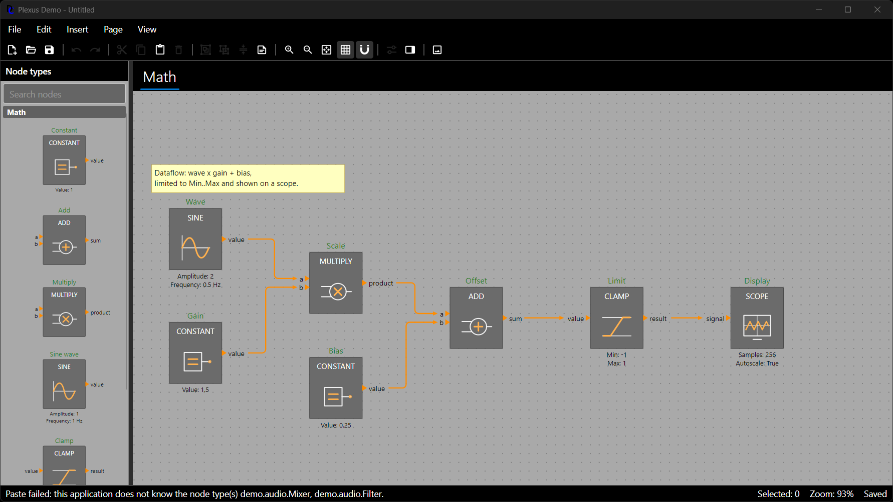

# Saving, Loading and the Clipboard

Plexus does no file or clipboard I/O of its own: the host decides where bytes go. It provides the text to write and to
read, in two formats that share one set of rules: a *snapshot* of a whole diagram for files, and a *clipboard payload*
for a selection of elements.

## Saving and Loading a Diagram

A diagram becomes JSON text with `ToJson()` and is rebuilt with `Diagram.FromJson()`. Loading needs a registry that
contains every node type the document uses; the types themselves are not stored.

```csharp
File.WriteAllText("diagram.json", diagram.ToJson());                       // indented JSON
diagram.History.MarkClean();                                              // the document is saved

Diagram loaded = Diagram.FromJson(File.ReadAllText("diagram.json"), types, options);   // options: see Configuration
```

Platform file pickers hand out streams, not paths, so both directions have a stream form. They use UTF-8 and leave the
stream open for the caller to dispose:

```csharp
await using var output = await file.OpenWriteAsync();
diagram.ToJson(output);

await using var input = await file.OpenReadAsync();
Diagram opened = Diagram.FromJson(input, types, options);
```

The snapshot holds the pages, nodes, wires with their routes, annotations, groups, property values and host data of the
node types that declare a `DataType`. It is versioned (`DiagramSnapshot.FormatVersion`) and uses only safe value types.
What it does not hold is *configuration*: the theme, router, connection rules and stylers are the host's, so they are
not in the file and a loaded diagram gets them from the `DiagramOptions` you pass (see *Configuration*). The undo history
is not saved either: a loaded diagram starts clean with an empty history.

Failures are reported with ordinary exceptions that a host catches around its Open command:

- `System.Text.Json.JsonException`: the text is not valid snapshot JSON.
- `SnapshotException`: a valid document that cannot be restored, for example one that uses an unknown node type (the
  message names it).
- `IOException` and `UnauthorizedAccessException`: the file could not be read (raised by your `File` call).

Load completely before replacing anything, so that a bad file leaves the open document untouched. The demo's `Open`
does exactly that: it builds the new `Diagram` first and swaps it in only when loading succeeded.

For hosts that keep diagrams in another container (a database, a project file), `diagram.ToSnapshot()`,
`Diagram.FromSnapshot(snapshot, types)` and the `PlexusJson` class convert between a diagram, its snapshot object
model and JSON text, and `diagram.ToTree()` / `Diagram.FromTree(tree, types)` give the same document as plain
dictionaries and lists for any other serializer. The chapter *Serialization and Custom File Formats* describes what a
snapshot contains and shows how a project writes its own format (TOML, with its own objects stored next to the diagram).

### Configuration

Configuration is applied to every diagram the host creates or loads. Put it in one `DiagramOptions` and pass that object
to every place that makes a diagram, so that a diagram that is new, opened or imported is configured the same way:

```csharp
using DemaConsulting.Plexus.Scene;

var options = new DiagramOptions
{
    Theme = DiagramTheme.Classic with { GridSize = 20 },
    ConnectionRules = ConnectionRules.All(ConnectionRules.Default, ConnectionRules.SameType),
    WireStyler = WireStylers.ByPortType(),
};

var fresh = new Diagram(types, options);                                          // New
var opened = Diagram.FromJson(File.ReadAllText("diagram.json"), types, options);   // Open (also FromSnapshot and FromTree)
existing.Apply(options);                                                          // a diagram that already exists
```

Members you leave out keep their defaults (or, for `Apply`, the current value). `options with { ... }` derives a variant.
The demo has one such object, `DemoAppearance.Options`, which its samples, `New`, `Open` and the command-line renderer
all use.

### Files With Unknown Node Types

A file may use node types that this application does not have (a newer version wrote it, or another set of plug-ins).
By default that is an error that names every missing type. A host that would rather open what it understands asks to
skip the rest and tells the user what was left out:

```csharp
var lenient = options with { UnknownNodeTypes = UnknownNodeTypeHandling.Skip };
Diagram opened = Diagram.FromJson(File.ReadAllText("diagram.json"), types, lenient);
if (opened.LoadReport.HasSkipped)
{
    ShowMessage(opened.LoadReport.Message);     // "Skipped 3 node(s) of unknown type(s) demo.Extra, 2 wire(s) ..."
}
```

Skipping removes the nodes of unknown types, the wires that touch them and their place in groups (a group left without
members disappears), and loads the rest exactly as a strict load would. Saving the result would lose the skipped part
for good, so a host usually opens such a file read-only or warns before saving. The clipboard is always strict.

## Copy and Paste

Copy and paste work on a selection: within a page, between pages, between diagrams and between applications. Internal
wires are kept, wires leaving the selection are dropped, and ids are regenerated on paste.

```csharp
string text = PlexusClipboard.Copy([a, sum]);                                   // versioned JSON text
PasteResult result = PlexusClipboard.Paste(page, text, new Point(300, 300));    // one undo entry
var copies = page.Duplicate([a, sum], 30, 30);                                  // copy and paste in one step
```

In the Avalonia editor Ctrl+C, Ctrl+X, Ctrl+V and Ctrl+D do this through the operating-system clipboard (see *The
Avalonia Editor*); the functions above are for hosts that move elements by themselves.

### When a Paste Fails

A paste is atomic: if anything prevents it, nothing is pasted and the result says why. The most useful failure is a
node type that the receiving application does not know, because users copy between instances of different versions or
different products:

```csharp
ShowMessage(result.Message);      // "Pasted 4 element(s)." or "Paste failed: this application does not know ..."
```

`Message` is ready to show: it summarizes a success (appending any warnings, which are non-fatal findings such as a value
that did not fit and was reset to its default), names the missing node types of a refused paste, and gives the reason
for any other failure. `result.MissingNodeTypes`, `result.Warnings` and `result.Error` stay available for a host that
wants to treat them differently.

The demo shows the whole path with two instances: start one with the full type set and one with `--types basic`, copy a
Mixer in the first and paste in the second. Nothing is pasted and the status bar reports
`Paste failed: this application does not know the node type(s) demo.audio.Mixer.` Pasting the other way round works,
because the basic types are a subset of the full ones.



Clipboard data is untrusted input: it uses explicit, versioned JSON with safe value types, applies size and element
limits (`PlexusClipboard.MaxPayloadBytes`, `MaxElements`), never uses binary deserialization and never chooses which
types to create. Wires that the target's connection rules refuse are skipped with a warning; duplicate does the same.
Loading a snapshot does not run the connection rules: a file is restored as written.
