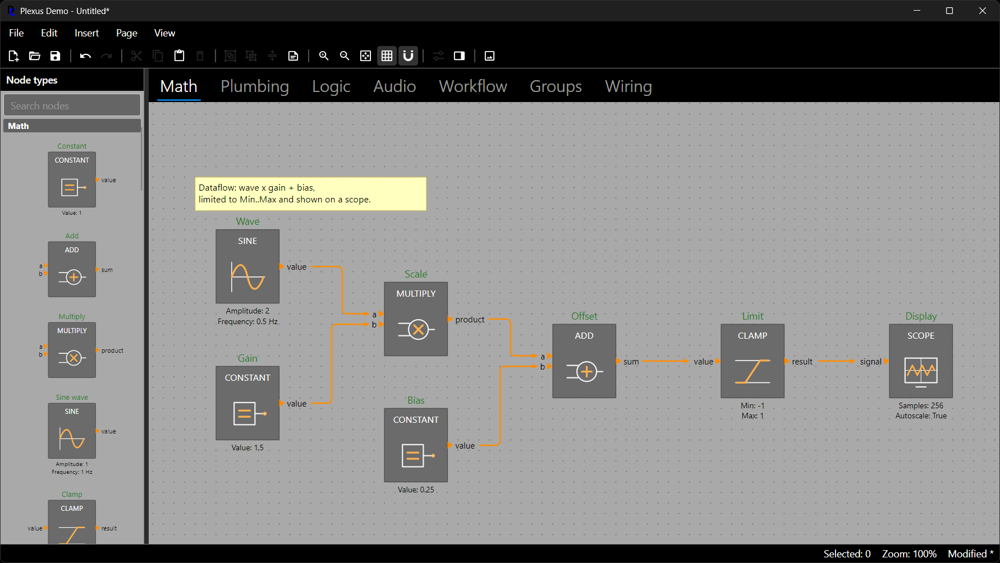
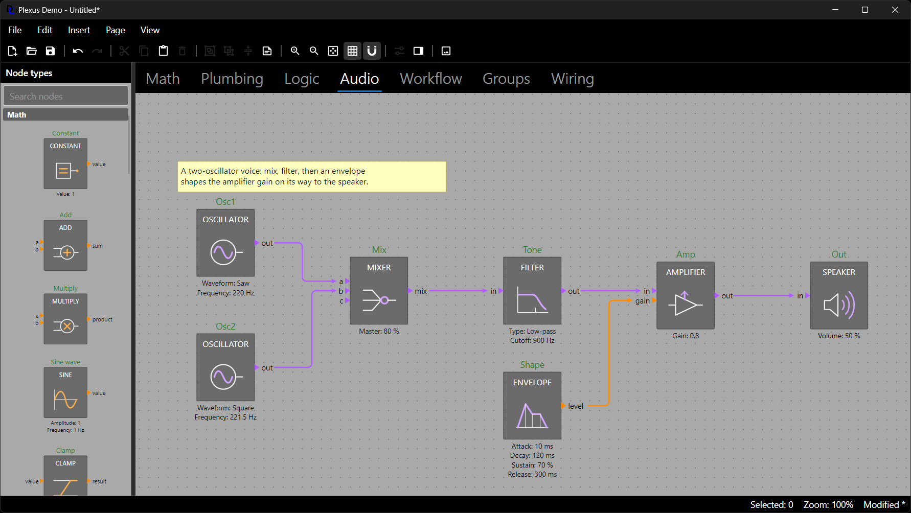

# Getting Started

## Installation

Install the packages you need using the .NET CLI:

```bash
dotnet add package DemaConsulting.Plexus
dotnet add package DemaConsulting.Plexus.Rendering
dotnet add package DemaConsulting.Plexus.Avalonia
dotnet add package DemaConsulting.Plexus.Avalonia.PropertyGrid
```

A server-side or command-line tool that builds and exports diagrams needs only the first two; a desktop application
that lets users edit diagrams needs `DemaConsulting.Plexus.Avalonia` as well, and
`DemaConsulting.Plexus.Avalonia.PropertyGrid` when it also wants a ready-made properties dialog or panel (see
*The Property Grid*). The examples in this guide assume a project with `ImplicitUsings` and `Nullable` enabled.

## Core Concepts

A **diagram** (`Diagram`) is the document root. It owns the registry of node types, an ordered list of **pages**, one
undo history, a theme, a wire router and the connection rules. A **page** (`DiagramPage`) holds the diagram elements:

- **Nodes** are instances of a node type. A node has a unique name, bounds, a property bag, an optional host payload
  (`Data`) and **ports**.
- **Ports** are typed, directional connection points: inputs on the left, outputs on the right.
- **Wires** connect an output port to an input port. Each wire stores its route (orthogonal bend points).
- **Annotations** are sticky notes and text boxes.
- **Groups** frame their members, nest, move their members together and can be collapsed into a summary box.

Every element has a string `Id`. The model is not thread-safe: use it from one (UI) thread. Every public mutation is
undoable and raises `Diagram.Changed`, including undo and redo themselves.

The types used in this guide live in the `DemaConsulting.Plexus` namespace unless noted: geometry in
`DemaConsulting.Plexus.Geometry`, routing in `DemaConsulting.Plexus.Routing`, scene and theme types in
`DemaConsulting.Plexus.Scene`, the renderer in `DemaConsulting.Plexus.Rendering` and the editor in
`DemaConsulting.Plexus.Avalonia`.

The model separates three concerns, and each chapter of this guide belongs to one of them:

| Concern       | Who owns it             | What it is                                                              |
|---------------|-------------------------|-------------------------------------------------------------------------|
| Vocabulary    | The host, once          | `NodeTypeRegistry`: port types, node types, properties, icons           |
| Content       | The user, per document  | `Diagram`: pages, nodes, wires, annotations, groups, undo history       |
| Configuration | The host, per diagram   | Theme, router, connection rules, wire and node stylers (never saved)    |

## A First Diagram

The host describes its vocabulary once. The running example of this guide is a small math dataflow: constants feed an
adder, and the adder feeds a scope. The chapter *Describing Your Domain* covers every option used here.

```csharp
using DemaConsulting.Plexus;
using DemaConsulting.Plexus.Geometry;

var types = new NodeTypeRegistry();
types.PortTypes.Add(new PortType("number", Color.Parse("#FF8C00")));
types.Add(new NodeType("math.Constant")
{
    Title = "CONSTANT",
    Category = "Math",
    Outputs = { new PortDefinition("value", "number") },
    Properties = { new PropertyDefinition("Value", 1.0) { ShowInSummary = true } },
});
types.Add(new NodeType("math.Add")
{
    Title = "ADD",
    Category = "Math",
    Inputs = { new PortDefinition("a", "number"), new PortDefinition("b", "number") },
    Outputs = { new PortDefinition("sum", "number") },
});
types.Add(new NodeType("math.Scope")
{
    Title = "SCOPE",
    Category = "Math",
    Inputs = { new PortDefinition("signal", "number") { AllowsMultipleWires = true } },
});
```

With the vocabulary in place, a diagram is a handful of calls, and a PNG of it one more:

```csharp
using DemaConsulting.Plexus.Rendering;

var diagram = new Diagram(types);
var page = diagram.Pages.Add("Main");
var a = page.AddNode("math.Constant", 30, 30, "A");
var b = page.AddNode("math.Constant", 30, 150, "B");
var sum = page.AddNode("math.Add", 240, 75, "Sum");
var scope = page.AddNode("math.Scope", 450, 75, "Scope");
page.Connect("A.value", "Sum.a");
page.Connect("B.value", "Sum.b");
page.Connect("Sum.sum", "Scope.signal");
a.Properties["Value"] = 2.5;                  // typed and validated against the declaration
PlexusRenderer.SavePng(page, "hello.png");    // headless: no window, no display
```

Every call that changes the diagram is validated, routed where it affects wires, and recorded as one undo entry.
Positions are in diagram units; the default grid is 15 units, so the coordinates above are multiples of it. Port names
are written as `"Node.port"` (the node's name, a dot, the port's name).



## Running the Demo

The repository contains a complete reference host application. It needs only the .NET SDK:

```bash
dotnet run --project demo/DemaConsulting.Plexus.Demo.Gui -- --sample showcase
dotnet run --project demo/DemaConsulting.Plexus.Demo.Cli -- --sample math --out out --scale 2
```

The first command opens the editor on the *showcase* diagram, which has one page for each sample domain: `math`,
`plumbing`, `logic`, `audio`, `workflow`, `groups` and `wiring`. The second renders a sample to PNG files in the folder
`out` without opening a window; it also renders your own diagram files (`plexus-demo-render diagram.json --out out`).
`--types basic` starts the GUI with a reduced type set, which is how the clipboard failure path is shown (see *Saving,
Loading and the Clipboard*).

The demo is split the way a real application would be: `DemaConsulting.Plexus.Demo.Model` holds everything the host
supplies (node types, port types, icons, sample diagrams, a file format and the dynamic appearance) and the GUI is a
thin window over it. When a chapter of this guide says "the demo does it like this", that is where to look.

### The Demo Domains

The demo ships five small, original node domains, each with its own port type and color, so that a diagram can mix
them freely:

| Domain   | Node types                                              | Port type (color) |
|----------|---------------------------------------------------------|-------------------|
| Math     | Constant, Add, Multiply, Sine, Clamp, Scope             | `number` (orange) |
| Plumbing | Pump, Valve, Tank, Junction, Flow Meter, Drain          | `fluid` (blue)    |
| Logic    | Switch, AND, OR, NOT, XOR, Lamp                         | `bool` (green)    |
| Audio    | Oscillator, Filter, Envelope, Amplifier, Mixer, Speaker | `audio` (violet)  |
| Workflow | Start, Task, Decision, Approval, Notify, End            | `flow` (yellow)   |

Each domain shows off a feature: plumbing has choice properties and pipes colored by the fluid, logic uses a custom node
visual and live wire colors, workflow carries host data and fan-in inputs, and audio is a two-oscillator voice with a
mixer, a filter and an envelope. The remaining samples are `groups` (nested and collapsed groups) and `wiring` (the
wire junction and crossing audit page).



### Things to Try

- Drag a node type from the palette onto the canvas, or double-click it, and widen the palette with its splitter to
  see more columns (*The Node Palette*).
- Double-click a **Switch** in the `logic` sample: the property changes, the wires recolor and the lamps light up
  (*Appearance: Themes and Styling*).
- Double-click a **Task** in the `workflow` sample to open the properties dialog, or choose *View > Properties Panel*
  (F4) for the docked panel (*The Property Grid*).
- Select some nodes and choose *Insert > Group Selection* and *Toggle Collapse* (*Building and Editing Diagrams*), then
  *Page > Move Selection To* another page.
- Click a wire to reshape it with its handles, and drag from a port to see the connection rules refuse a wire with a
  reason (*Wires, Routing and Connection Rules*).
- Right-click anything for its context menu, press Ctrl+Z and Ctrl+Y, and watch the status bar (*The Avalonia Editor*).
- Use *File > Export Page PNG* to render the current page (*Rendering to PNG*).

## API Reference

Each package ships a Markdown API reference in its `api/` folder, generated from the XML doc comments on every build
and organized for gradual disclosure: `api/api.md` is the index (one row per namespace), each namespace has a page
that opens with a short usage example and an overview, each type has a page and each member its own page. Read the
namespace page first, then follow the links to the types and members you need. The `DemaConsulting.Plexus` page is a
"hello diagram", and the `Scene`, `Routing`, `Rendering` and `Avalonia` pages show styling, custom routers, headless
PNG rendering and a complete first application with its palette.

To read it from a restored package, open the package folder under the NuGet cache (for example
`~/.nuget/packages/demaconsulting.plexus/{version}/api/api.md`), or unzip the `.nupkg`. When building this repository,
the same files are written to the `api/` folder of each project under `src/` (ignored by git).

## Next Steps

The chapters build on each other in the order of the table of contents; pick the ones that match your goal:

- **Describe your own nodes, ports and properties**: *Describing Your Domain*
- **Create and change diagrams in code, with undo**: *Building and Editing Diagrams* and *Undo, Redo and Dirty Tracking*
- **Save, load and copy diagrams**: *Saving, Loading and the Clipboard* and *Serialization and Custom File Formats*
- **Produce pictures without a window**: *Rendering to PNG*
- **Let users edit diagrams in a desktop application**: *The Avalonia Editor*, *The Node Palette* and *The Property Grid*
- **Change how nodes and wires look or are routed**: *Appearance: Themes and Styling* and *Wires, Routing and Connection
  Rules*
- **Replace a default or add a hook**: *Extending Plexus*
- **Test and script your application**: *Testing and Automating*

The quickest way to a working editor is *A First Application* in *The Avalonia Editor*: a window with a palette, page
tabs and the editor, in one XAML file and a short code-behind.
