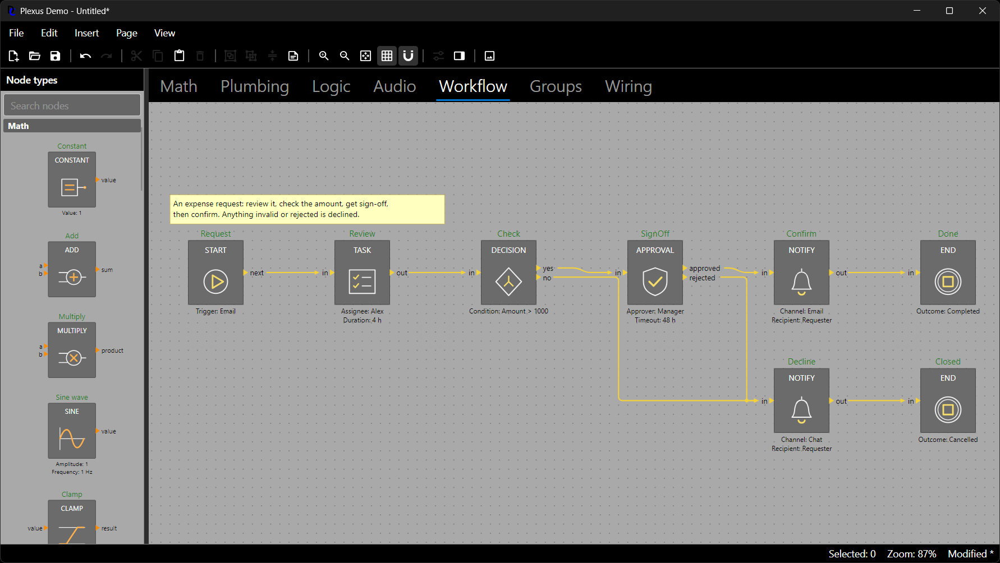

# Describing Your Domain

The host declares its vocabulary in a `NodeTypeRegistry`: the kinds of data that flow through ports (port types) and
the kinds of nodes a user can place (node types). The registry is configuration that the host creates once at start-up
and gives to every diagram. Plexus ships no node types of its own.

## Port Types

A port type is a host-chosen string key with a color. Ports of a type are drawn with its color, and so are the wires
leaving them when a wire styler asks for it (see *Appearance: Themes and Styling*). Nothing is predefined; a key that
was never registered still renders, in neutral gray.

```csharp
types.PortTypes.Add(new PortType("number", Color.Parse("#FF8C00")));   // orange
types.PortTypes.Add(new PortType("bool", Color.Parse("#2EBF5B")));     // green
```

`Color.Parse` accepts `#RRGGBB` and `#AARRGGBB`; `Color.FromRgb`, `Color.FromArgb` and named constants such as
`Color.Orange` exist as well. An optional `DisplayName` (for example `new PortType("bool", green) { DisplayName =
"Boolean" }`) is the readable name editors show in port tooltips; it defaults to the key. The demo declares five port
types (number, bool, fluid, audio and flow), one for each of
its domains, so that the colors tell the domains apart at a glance.

## Node Types

A node type is declared with an object initializer. Only the key is required; everything else has a sensible default.

```csharp
types.Add(new NodeType("math.Sine")
{
    Title = "SINE",                   // the header text; defaults to the last segment of the key
    DisplayName = "Sine wave",        // the host-facing name used by palettes, menus and accessibility
    Category = "Math",                // the palette groups types under category headers
    DefaultSize = new Size(90, 105),  // otherwise the theme's default size, grown to fit the ports and the title
    Icon = IconSource.FromSvg("<svg xmlns='http://www.w3.org/2000/svg' viewBox='0 0 16 16'>" +
                              "<path d='M1 8 C4 0 7 0 8 8 S12 16 15 8' fill='none' stroke='#FFB04D'/></svg>"),
    Outputs = { new PortDefinition("value", "number") },
    Properties =
    {
        new PropertyDefinition("Amplitude", 1.0) { ShowInSummary = true },
        new PropertyDefinition("Frequency", 1.0) { Unit = "Hz", ShowInSummary = true },
    },
});
```

Notes:

- The key is an opaque string, namespaced by convention (`com.acme.Amplifier`, `demo.math.Add`). It is written to
  files and to the clipboard, so choose keys that never change; a paste into another application requires an exact
  match.
- A type is frozen when it is added to the registry: its port and property lists cannot change afterwards.
- Without a `DefaultSize`, a new node is as wide as the theme's `DefaultNodeWidth` (90) or wider: the width grows, in
  steps of the grid size, until the title fits the header on one line (measured with the deterministic
  `ApproximateTextMeasurer`), and the height grows to fit the longer port column. A declared `DefaultSize` is
  authoritative: a title wider than it wraps onto further lines, or shrinks, instead of widening the node.
- `NodeType.Category` is `null` for an uncategorized type. The `NodePalette` shows categories in registration order and
  uncategorized types last.
- `IsResizable` is a hint for hosts that let users resize nodes of a type; the editor does not resize nodes itself.
- Every registry is independent. Two instances of one application may know different types, which is exactly what
  makes the clipboard failure path testable (see *Saving, Loading and the Clipboard*).

## Ports

Inputs are drawn on the left edge and outputs on the right edge, top to bottom in declaration order. A port has a
`Name` (used in code and in `"Node.port"` paths), a type key and a `Label` (the text drawn beside it, which defaults to
the name).

```csharp
types.Add(new NodeType("audio.Mixer")
{
    Title = "MIXER",
    Inputs =
    {
        new PortDefinition("in", "number") { AllowsMultipleWires = true },   // fan-in: several wires may end here
        new PortDefinition("gain", "number") { Label = "Gain (dB)" },        // the name is for code, the label for people
    },
    Outputs = { new PortDefinition("out", "number") },
});
```

An input accepts one wire unless its definition says `AllowsMultipleWires = true`; outputs always fan out. Port names
must be unique within a direction. An input and an output of one node may share a name, in which case
`node.Port("flow")` is ambiguous and throws: use `node.Input("flow")` or `node.Output("flow")`. Wires are covered in
*Wires, Routing and Connection Rules*. A port may also carry a `Description` (what it carries or expects), which the
editor shows in the port's tooltip.

### Ports That Vary per Node

Some blocks are configurable: a bus with a number of channels, a gate with a number of inputs, a router whose outputs
come from its data. Give such a type a `PortProvider`: a function of the node that returns its ports as a `PortSet`.
Plexus calls it when a node is created (after its default data), when a node is loaded, pasted or duplicated (after
its stored properties and data, before its wires), and after every change of the node's `Properties` or `Data`.

```csharp
types.Add(new NodeType("demo.Bus")
{
    Inputs = { new PortDefinition("in0", "number"), new PortDefinition("in1", "number") },   // the defaults: 2 channels
    Outputs = { new PortDefinition("out", "number") },
    Properties = { new PropertyDefinition("Channels", 2) },
    PortProvider = node => new PortSet(
        Enumerable.Range(0, Math.Clamp(node.Properties.Get<int>("Channels"), 1, 16))
            .Select(i => new PortDefinition($"in{i}", "number") { Description = $"Channel {i}" }),
        [new PortDefinition("out", "number")]),
});

var diagram = new Diagram(types);
var page = diagram.Pages.Add("Main");
var bus = page.AddNode("demo.Bus", 0, 0);   // gets in0 and in1 from the provider

bus.Properties["Channels"] = 4;    // one undo entry: the property, the new inputs in2 and in3
bus.Properties["Channels"] = 1;    // in1..in3 and their wires are removed; in0 keeps its wire
diagram.History.Undo();            // back to four inputs, every wire included
```

What happens when the ports are recomputed:

- **The port name is the identity.** Within a direction, a port whose name is still there keeps its `Port` object and
  its wires, even when it moved to another row or its label or type changed. A name that disappeared takes its wires
  along. So use stable names (`in0`, `in1`, ...): renaming a port drops its wires, and renumbering channels re-attaches
  the wires by name, not by position. Port names must be unique within a direction; `PortSet` refuses duplicates.
- **Wires the rules no longer allow are removed.** When a kept port changes its type or its fan-in, each of its wires
  is checked again with the diagram's `ConnectionRules`; with `ConnectionRules.SameType` installed, a wire whose types
  no longer match is removed. The wires are checked in page order (the order of `DiagramPage.Wires`), each as a
  reconnect of itself (it does not count against its own port, and your rule sees it as
  `DiagramPage.WireBeingReconnected`), after the wires refused before it were removed. So when an input that accepted
  several wires (fan-in) now accepts only one, every earlier wire is refused and the wire latest in page order stays.
- **The node fits its ports when their number changes.** When the number of inputs or outputs changes, the node takes
  the height its longer port column needs, but never less than its type's default height (exactly the size a newly
  added node with those ports gets), keeping its position and width, and the wires whose ends moved are re-routed. So
  it grows when ports are added and shrinks back when they are removed; a height the user set is replaced by the fitted
  height. A recomputation that keeps the number of inputs and outputs (a retyped, relabeled or reordered port) leaves
  the size alone.
- **One undo entry.** The property (or data) change, the removed wires, the new ports, the resize and the re-routes
  are one entry; undo restores the exact previous ports (the same objects), wires and size. An edit that does not
  change the ports records only the edit. A batch edit (`node.Properties.TrySetAll(...)`, which the node properties
  dialog uses, together with the data copy it commits) calls the provider once, for the final values, so a port that is
  present before and after the batch keeps its wires even when some combination of the values passed through would
  not have it.
- **Hosts see it through the usual notifications.** `Diagram.Changed` reports each removed wire
  (`ElementRemoved`) before the node reports `Ports` as changed (`ElementChanged`); undo reports the wires as added
  again. `Ports` is reported exactly once per edit, undo and redo, when the node is settled: after the removed wires,
  the new size and the re-routed wires (on undo, after everything is restored), followed by a `Bounds` change of each
  group the node is in.
- **An empty set is fine; null is not.** A provider may return a `PortSet` with no inputs, no outputs or neither; the
  node then has no ports in that direction, the wires of its former ports there are removed, and its height is the
  type's default height. Returning null is a mistake and fails like an exception (below), with a message naming the node
  type.
- **Ports are not saved.** Files and the clipboard store properties, data and wires (by port name); loading recomputes
  the ports first, so wires on computed ports come back. A file whose wire names a port that the provider no longer
  produces fails to load like any other unknown port, and a paste of it is refused with a message. Stored node sizes
  are kept on load.

Keep the provider fast, deterministic and free of side effects, and let it read only the node's `Type`, `Properties` and
`Data`: it may run for a node that is not on a page yet, and redo replays the recorded result instead of calling it
again. If it fails - it throws an exception of any type, returns null or builds an invalid `PortSet`, or a connection
rule throws while the wires are checked again - nothing is left half done:

- after a property or data change, the change and everything it caused are rolled back, nothing is recorded in the
  history, and the exception reaches the caller;
- `AddNode` adds nothing and throws;
- loading (`Diagram.FromJson`, `FromSnapshot`, `FromTree`) throws a `SnapshotException`;
- a paste returns a failed `PasteResult` with the message, and `DiagramPage.Duplicate` throws an
  `InvalidOperationException`; in both cases the page is unchanged.

The declared `Inputs` and `Outputs` stay the type's defaults and should equal what the provider returns
for a new node: palettes, the drop preview and `NodeGeometry.RoutingObstacles(Rect, NodeType, DiagramTheme)` use
them. A host that holds a `Port` the provider removed cannot connect it any more (`CanConnect` says why).

The demo's AND, OR and XOR gates use a provider: their `Inputs` property (2 to 8) gives them inputs named `a`, `b`,
`c`, ...; a two-input gate has exactly the ports of a gate without the property, so older files keep their wires.

## Descriptions and Tooltips

Node types and ports carry text that editors show when the pointer rests on them; the library never draws it.

```csharp
types.Add(new NodeType("demo.Lamp")
{
    Description = "Lights while its input is on.",                       // the tooltip when there is no function
    ToolTip = node => $"Lights while its input is on.\nNow: {(IsLit(node) ? "lit" : "dark")}",   // live state
    Inputs = { new PortDefinition("in", "bool") { Description = "Lights the lamp while on." } },
});
```

`NodeType.GetToolTip(node)` returns the result of `ToolTip` when the type has one, otherwise `Description`. The
function's result is used as it is: return null or an empty string for "no tooltip right now" - the `Description` is
not used in its place. The function runs each time the pointer moves onto the node, so it can show live values or your
validation messages for the node (return several lines separated by `\n`). Exceptions it throws are not caught: they
reach the caller of `GetToolTip` (and so the editor), so keep the function simple. For per-host logic that does not
belong in the type, handle `DiagramEditor.ToolTipRequested` instead (see *The Avalonia Editor*).

## Properties

Properties are the typed values a user edits on a node. The kind of a property is inferred from the default value, and a
string property with `Choices` becomes a choice property (the list must be non-empty, without duplicates or null
entries, and contain the default).

| Default value          | Kind      | A host editor typically uses |
|------------------------|-----------|------------------------------|
| `true`                 | boolean   | a check box                  |
| `3`, `3L`              | integer   | a numeric box                |
| `1.5`                  | double    | a numeric box                |
| `"text"`               | string    | a text box                   |
| `"Fast"` with `Choices`| choice    | a combo box                  |
| `Color.Red`            | color     | a color picker               |

```csharp
types.Add(new NodeType("math.Clamp")
{
    Title = "CLAMP",
    Inputs = { new PortDefinition("value", "number") },
    Outputs = { new PortDefinition("result", "number") },
    Properties =
    {
        new PropertyDefinition("Min", 0.0) { ShowInSummary = true },
        new PropertyDefinition("Max", 1.0) { ShowInSummary = true, Unit = "V" },
        new PropertyDefinition("Mode", "Hard") { Choices = ["Hard", "Soft"], Description = "How limits apply" },
        new PropertyDefinition("Enabled", true) { Category = "Behavior" },
    },
});
```

Presentation members (`DisplayName`, `Category`, `Order`, `Description`, `Unit`, `EditorHint`, `IsReadOnly`, `Format`)
are hints for the property grid, the host's own property editor and for the node summary; they never restrict
programmatic changes. `ShowInSummary` puts `Name: value unit` in the text drawn under the node, and `Format` customizes
how a value is written there. `Order` sets where a property appears within its category in a categorized property
editor: lower values come first, any whole number is allowed (negative values move a property ahead of the default 0),
and properties with equal values (all of them are 0 by default) are listed by display name, ignoring case. An
alphabetical view ignores `Order`, and it never changes the order of `NodeType.Properties`, of a node's property values,
of the node summary or of saved documents. Use it when properties read naturally in a fixed sequence:

```csharp
Properties =
{
    new PropertyDefinition("Attack", 10.0) { Unit = "ms", Category = "Envelope", Order = 1 },
    new PropertyDefinition("Decay", 120.0) { Unit = "ms", Category = "Envelope", Order = 2 },
    new PropertyDefinition("Sustain", 70.0) { Unit = "%", Category = "Envelope", Order = 3 },
    new PropertyDefinition("Release", 300.0) { Unit = "ms", Category = "Envelope", Order = 4 },
},
```

A node's values live in its `PropertyBag`. Reading and writing are one-liners; every write is validated against the
declaration, converted only where the value is kept exactly (a `long` too large for a `double` to hold exactly is
rejected for a double property) and recorded as an undo entry:

```csharp
a.Properties["Value"] = 4.0;                            // ArgumentException when the value does not fit the kind
double value = a.Properties.Get<double>("Value");
a.Properties.Reset("Value");                            // back to the declared default (undoable)
a.Properties.PropertyChanged += (_, e) => ShowMessage($"{e.PropertyName} changed");
```

Properties that were never declared are *ad hoc*: they can be set and read like declared ones and are saved with the
node, but have no definition to validate against. A definition parses the text a user typed with
`definition.TryParse(text, out value, out error)` and formats a value for an edit box with
`PropertyDefinition.FormatForEdit(value)`; `node.Properties.TrySetAll(...)` applies a whole dialog at once (see *Editing
Properties* in *The Avalonia Editor*).

## Icons

An icon is SVG supplied by the host; Plexus ships no icon library. Keep icons within the common SVG subset (paths,
basic shapes, fills, strokes, groups) so the headless renderer and the Avalonia editor look alike. A malformed icon is
skipped rather than failing the render.

```csharp
var inline = IconSource.FromSvg("<svg xmlns='http://www.w3.org/2000/svg' viewBox='0 0 16 16'>...</svg>");
var fromFile = IconSource.FromSvgFile("icons/sine.svg");                     // read immediately
var embedded = IconSource.FromSvgResource(System.Reflection.Assembly.GetExecutingAssembly(), "MyApp.Icons.sine.svg");
```

The demo embeds its icons so that it works from any working directory: the project file contains
`<EmbeddedResource Include="Icons\*.svg" LogicalName="Icons.%(Filename)%(Extension)" />` and the node types ask for
`Icons.Sine.svg`. Without `LogicalName` the resource name is the root namespace followed by the folder path and file
name (`MyApp.Icons.sine.svg`); `assembly.GetManifestResourceNames()` lists the real names. An icon can be recolored per
node with `NodeStyle.IconTint` (see *Appearance: Themes and Styling*).

## Summary Lines

By default a node shows the properties marked `ShowInSummary`. A node type can compute its own lines instead; the
function runs every time the scene is built, so the text follows property changes.

```csharp
types.Add(new NodeType("math.Gain")
{
    Title = "GAIN",
    Properties = { new PropertyDefinition("Gain", 1.0) },
    Summary = node => [$"x {node.Properties.Get<double>("Gain"):0.##}"],
});
```

## Host Data

Properties are flat, typed and editable by the generic machinery. When a node needs a richer payload, attach any
application object to `Node.Data`. Declare the exact CLR type as `NodeType.DataType` and the payload survives the
clipboard and JSON files (serialized with `System.Text.Json`; no type name is ever read from a document).

```csharp
public sealed record TaskDetails(string Notes, int Priority);

types.Add(new NodeType("flow.Task")
{
    Title = "TASK",
    Inputs = { new PortDefinition("in", "flow") { AllowsMultipleWires = true } },
    Outputs = { new PortDefinition("out", "flow") },
    DataType = typeof(TaskDetails),
});

var task = page.AddNode("flow.Task", 0, 300);
task.Data = new TaskDetails("Review the invoice", 4);    // undoable; replaces the whole payload
var details = (TaskDetails?)task.Data;
```

Assigning `Data` replaces the payload and is one undo step, so prefer immutable records: change a payload by assigning
a modified copy (`task.Data = details with { Priority = 5 }`). When the type declares a `DataType`, assigning an
instance of an incompatible type throws `ArgumentException` immediately (a derived type and `null` are fine), instead of
failing later when the diagram is saved. `DataType` is optional when a `DataSerializer` is set: a serializer alone is
enough to persist the payload (then `Data` accepts any object; declare both only when you also want the type check). A
type with neither `DataType` nor `DataSerializer` has its
`Data` left out of files and of the clipboard. The demo's workflow `Task` node does exactly this, with a mutable class
whose properties carry `System.ComponentModel` annotations: the property grid (see *The Property Grid*) shows and edits
such host data next to the declared properties, working on a copy made with `node.CloneData()`.

### Starting Data for New Nodes

A node starts with `Data == null`, which makes a property grid for a node with host data empty until the host assigns
something. Give the type a factory and every new node gets its own payload:

```csharp
types.Add(new NodeType("flow.Task")
{
    DataType = typeof(TaskDetails),
    CreateData = () => new TaskDetails("", 3),      // called once per new node; return a new instance each time
});

var task = page.AddNode("flow.Task", 0, 300);       // task.Data is already a TaskDetails
```

The factory is used for nodes added from code, dropped from the palette, added with the editor's commands and for pasted
or duplicated nodes whose source carried no data. Nodes loaded from a file keep exactly what was saved, including no data,
and undo and redo of the add keep the same payload object. A factory result that does not fit `DataType` throws
`InvalidOperationException` when the node is added.



A custom serializer for payloads that need other JSON settings is described in *Extending Plexus*.
