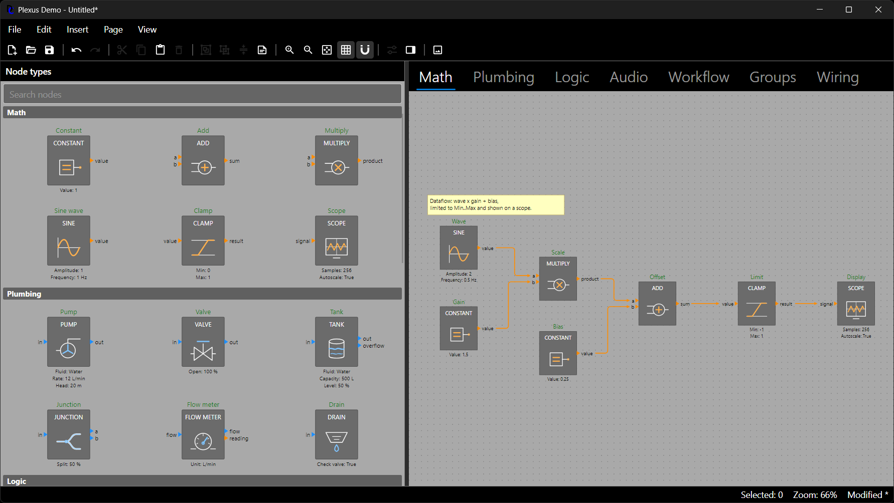
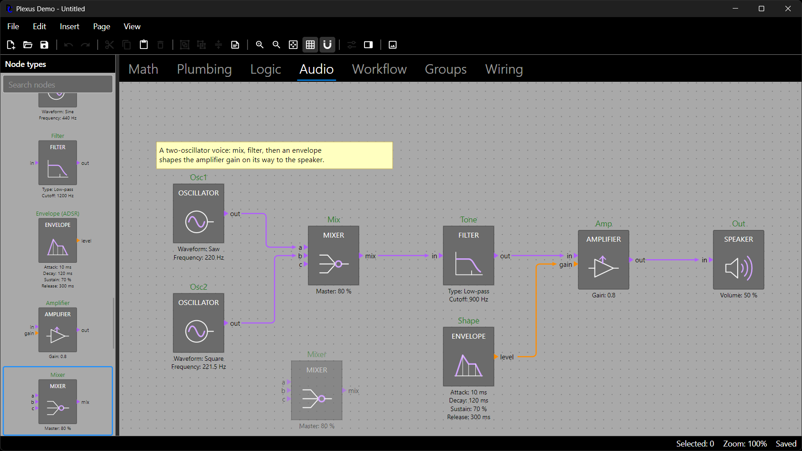

# The Node Palette

`NodePalette` is a ready-made palette of node types. Every item is drawn by the same scene builder and painter as the
canvas, so it looks exactly like a freshly added node of that type: box, header, icon, ports, port labels, the summary
of default property values, any custom node visual, and the type's display name above the box. It groups the types
under their `NodeType.Category` headers, has a search box, lays its items out in as many columns as the pane is wide
and creates nodes when an item is dragged onto the editor or activated.



## Binding the Palette to an Editor

Point the palette at the editor and it needs no code at all:

```xml
<Grid ColumnDefinitions="220,5,*">
  <plexus:NodePalette Editor="{Binding #Editor}" />
  <GridSplitter Grid.Column="1" ResizeDirection="Columns" />
  <plexus:DiagramEditor x:Name="Editor" Grid.Column="2" />
</Grid>
```

With `Editor` set, the palette

- lists the node types of the editor's diagram and follows the editor when it shows another diagram (a new document
  or File > Open replaces it), and draws with the editor's theme;
- has a search box on top that filters by display name, title, key and category, without regard to case;
- creates a node when an item is dragged onto the editor, and when an item is activated by double-click or Enter: the
  node is added at the visible center of the editor, selected, as one undo entry (`DiagramEditor.AddNodeAtCenter` does
  the same from a menu).

The demo's whole integration is one expression, `new NodePalette { Editor = Editor, Zoom = 0.75 }`.



While a type is dragged over the editor, a translucent ghost of the node shows where it lands, snapped to the grid;
the editor handles the drop, so nothing else has to be set up. A drop onto a read-only editor, or of an unknown key,
is ignored.

## Layout: Categories, Columns and Zoom

Categories appear in registration order; uncategorized types come last under `UncategorizedHeader` ("Other" by
default). Set `GroupByCategory` to false for a flat list.

The palette lays the items of each category out in a grid. Each cell is as wide as the widest item (the widest reach of
any label to the left of a box plus the widest to the right, plus padding), and as many cells as fit the palette's width
form a row. A wide palette shows two, three or more columns and a narrow one a single column, automatically and again
whenever the palette is resized, the zoom or the filter changes or types are added. The node boxes line up in columns
and rows, and the category headers span the full width. Give the user a way to widen the palette, such as the
`GridSplitter` above, and the extra room is used.

```csharp
using DemaConsulting.Plexus.Avalonia;

Palette.MaxColumns = 1;               // 0 (the default) means as many as fit; 1 makes a plain list
Palette.MinColumnSpacing = 8;         // the smallest space between two cells, in device-independent pixels
Palette.Zoom = 0.75;                  // fixed item size (the demo's choice); bind to Editor.Zoom to follow the canvas
Palette.GroupByCategory = false;
```

A fixed `Zoom` keeps the items one comfortable size while the canvas zooms and is cheaper than rebuilding every item
on each wheel step. The content scrolls horizontally only when one cell is wider than the palette, never because of the
number of columns.

## Searching

The search box is on by default (`ShowFilter`; prompt "Search nodes"). The filter text is also a property, so a host
can drive it or replace the box with its own:

```csharp
Palette.Filter = "gain";              // case-insensitive over name, title, key and category
Palette.ShowFilter = false;           // hide the built-in box and bring your own
```

## Choosing What Is Shown

An explicit `Types` or `DiagramTheme` always wins over the editor's. Without an editor, give the palette a
`NodeTypeRegistry` (or any sequence of `NodeType`):

```xml
<plexus:NodePalette Types="{Binding Registry}" />
```

A plain sequence of types has no port types, so ports are drawn gray; pass the registry to get the port colors. A
palette shows what a registry held when it was bound; after adding types to a registry that is already shown, call
`Palette.Refresh()`.

```csharp
types.Add(new NodeType("math.Late") { Title = "LATE", Category = "Math" });
Palette.Refresh();                    // pick up types added after binding
```

The palette shows each type's default look: prototypes are built from a private diagram, so a `NodeStyler` of your
diagram does not restyle them.

## Activation

Activating an item (double-click, or Enter on the selected item) adds a node to the bound editor. A host takes over
activation with `NodeTypeActivated`; setting `Handled` stops the default action:

```csharp
using DemaConsulting.Plexus.Geometry;

Palette.NodeTypeActivated += (_, e) =>
{
    page.AddNode(e.NodeType, new Point(60, 60));
    e.Handled = true;
};
```

## Keyboard, Selection and Code Control

The arrow keys, Home and End move the selection (`SelectedNodeType`). With several columns Left and Right move within
a row and Up and Down by a row, in the same column or the nearest one when a row is shorter, and across category
headers. From the search box, Down and Up move through the results and Enter activates the selected one. The same is
available from code, which is what tests, scripts and menus use:

```csharp
var addType = types.Get("math.Add");
Palette.Select(addType);              // select the item and scroll it into view
Palette.ScrollIntoView(addType);
Palette.Activate(addType);            // the same as a double-click
IReadOnlyList<NodeType> shown = Palette.VisibleTypes;      // what survives filter and grouping, in display order
```

Items are named after the type's display name and carry the automation id `NodePalette.GetAutomationId(type)`:
`NodePalette_` plus the key with every character other than a letter, digit or underscore replaced by an underscore
(`NodePalette_math_Add` for `math.Add`). The search box has the id `NodePalette_Filter`
(`NodePalette.FilterAutomationId`). UI automation tools can scroll an item into view with the ScrollItem pattern and
activate it with the Invoke pattern, so a driver never needs to filter the palette down to reach an entry.

## Palettes Built by the Host

A host that prefers its own toolbox (buttons, a list, a ribbon) can make any control a drag source in one call; the
editor is the drop target and needs no setup:

```csharp
using Avalonia.Controls;

var button = new Button { Content = "Add" };
IDisposable dragSource = DiagramEditor.EnableNodeTypeDrag(button, "math.Add");    // dispose to stop listening
```

Clicks and double-clicks on the control keep working. When the host starts the drag itself, call
`DiagramEditor.StartNodeTypeDragAsync(pointerPressedEventArgs, key)` from a `PointerPressed` handler, or
`CreateNodeTypeDataTransfer(key)` to build the payload. Dropping creates a node of that type centered at the drop point
as one undo entry and selects it.
