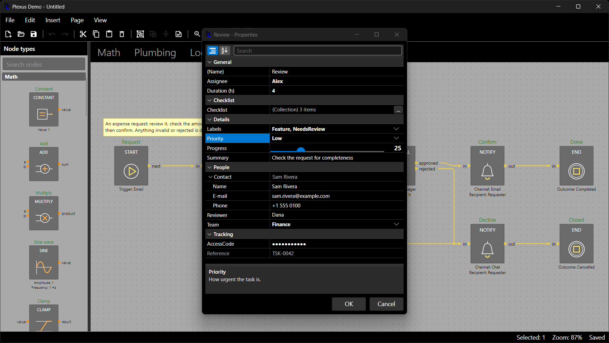
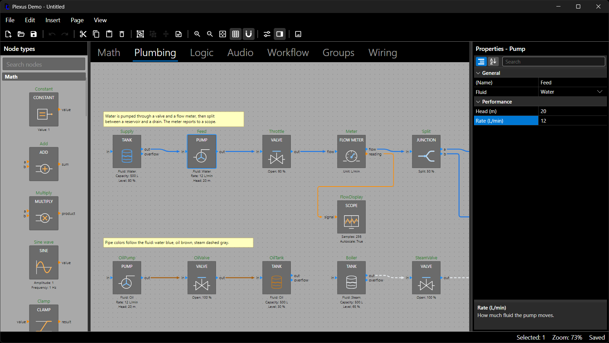
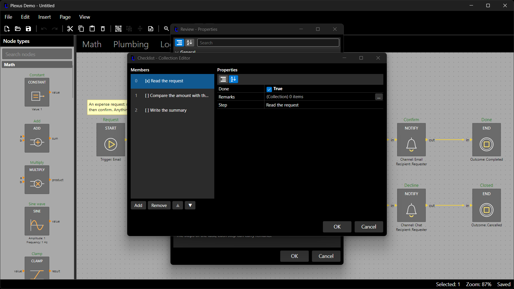

# The Property Grid

`DemaConsulting.Plexus.Avalonia.PropertyGrid` is an Avalonia property grid in the style of the WinForms one: give it any
.NET object and it shows and edits the object's properties, honoring the `System.ComponentModel` annotations
(`[Category]`, `[Description]`, `[DefaultValue]`, `[TypeConverter]`, ...). It is generic: nothing in the grid itself
knows about Plexus. A small adapter layer in the same package shows Plexus nodes, annotations and groups, and makes every
commit **one undo entry** of the diagram, so the properties dialog of a node is one line of host code.



## Showing Any Object

Annotate a class and give an instance to the grid:

```csharp
using System.ComponentModel;
using Avalonia.Controls;
using DemaConsulting.Plexus.Avalonia.PropertyGrid;

public enum Shape { Sine, Square, Saw }

public class Channel
{
    [Description("The name shown in lists.")]
    public string Name { get; set; } = "channel";

    [DefaultValue(false)]
    public bool Muted { get; set; }
}

[TypeConverter(typeof(ExpandableObjectConverter))]
public class Limits
{
    public double Low { get; set; }
    public double High { get; set; } = 1;

    public override string ToString() => $"{Low} .. {High}";
}

public class Mixer
{
    [Category("Levels"), Description("Output level in dB."), DefaultValue(0.0)]
    public double Gain { get; set; }

    [Category("Levels"), DisplayName("Wave shape"), DefaultValue(Shape.Sine)]
    public Shape Shape { get; set; }

    [Category("Levels")]
    public Limits Range { get; set; } = new();

    [Category("Channels")]
    public List<Channel> Channels { get; set; } = [new Channel { Name = "left" }, new Channel { Name = "right" }];

    [Category("Security"), PasswordPropertyText(true)]
    public string Key { get; set; } = "";

    [Browsable(false)]
    public int Revision { get; set; }
}

var mixer = new Mixer();
var grid = new PropertyGrid { SelectedObject = mixer };      // categorized, with search and a description pane
```

The grid lists the properties in categories (or alphabetically), with a search box, collapsible categories, a
description pane, expandable nested objects (`Range`), a "..." button that opens the collection editor for collections
(`Channels`) and inline validation: a value that cannot be converted, or that fails a `[Range]` or `[Required]`
attribute, gets a red border and the reason. A value that differs from its `[DefaultValue]` is shown in bold, and a
context menu of such a row resets it.

### Supported Annotations

| Annotation or type                   | Effect in the grid                                                    |
|--------------------------------------|-----------------------------------------------------------------------|
| `[Category]`                         | The category band the property is listed under (default "Misc").      |
| `[DisplayName]`, `[Description]`     | The row label and the text of the description pane (`[Display]` too). |
| `[ReadOnly(true)]`, no setter        | The row is dimmed and cannot be edited.                               |
| `[Browsable(false)]`                 | The property is not listed.                                           |
| `[DefaultValue]`                     | A different value is bold; the row can be reset.                      |
| `[TypeConverter]`                    | Text conversion and standard values (a closed or editable list).      |
| `ExpandableObjectConverter`          | A nested object whose properties are shown as child rows.             |
| `enum`, `[Flags] enum`               | A drop-down, or a check list.                                         |
| `bool`                               | A check box.                                                          |
| Avalonia or `System.Drawing` `Color` | A swatch and a hex text (`#RRGGBB`).                                  |
| `List<T>`, arrays, `ICollection<T>`  | The collection editor: add, remove, reorder, edit members.            |
| `[PasswordPropertyText(true)]`       | The text is masked.                                                   |
| `[ParenthesizePropertyName]`         | The label is shown as `(Name)` and sorted first.                      |
| `[RefreshProperties(All)]`           | All rows are read again after the property changes.                   |
| `[DefaultProperty]`                  | The row that is selected first.                                       |
| `[PropertyEditor("key")]`            | A custom editor (see below).                                          |
| `[UIHint("key")]`                    | The same, without referencing the grid assembly (see below).          |
| `[Range]`, `[Required]`, ...         | The value is validated before it is written.                          |

Text is converted with the current culture, as in the WinForms grid. The properties of a type with a
`ICustomTypeDescriptor` or a `TypeDescriptionProvider` are listed as the descriptors say.

## Live and Staged Editing

A grid edits through a `PropertyEditSession` (`grid.Session`). In `PropertyEditMode.Live` (the default) every edit is
written to the object at once, which suits a docked panel. In `PropertyEditMode.Staged` edits are buffered and the object
is untouched until the host calls `Commit`; `Cancel` throws them away, which is what an OK and Cancel dialog does:

```csharp
var staged = new PropertyGrid { EditMode = PropertyEditMode.Staged, SelectedObject = mixer };
// ... the user edits ...
if (staged.Session!.HasChanges)
{
    CommitResult result = staged.Session.Commit();     // writes the pending edits in order; failed ones stay pending
    if (!result.Succeeded)
    {
        Console.WriteLine(string.Join("\n", staged.Session.GetErrors().Values));
    }
}
```

An invalid value never reaches the object: `Session.SetText` and `SetValue` return a result with the reason and the grid
shows it on the row. `Session.HasErrors` is false when everything is acceptable.

### Commit Scope and Undo

Both modes run the writes inside an optional *commit scope*: a hook that receives the action that performs the writes
and must run it exactly once. Staged commits call it once for all edits, live mode once per edit. It is where a host
makes the writes one undo step:

```csharp
var undoable = new PropertyGrid
{
    EditMode = PropertyEditMode.Staged,
    CommitScope = apply => diagram.History.Transact("Edit mixer", apply),
    SelectedObject = mixer,
};
```

## A Dialog in One Call

`PropertyGridDialog.ShowAsync` shows an object in a staged grid with OK and Cancel. OK commits (inside the commit scope,
if one is given) and completes with `true`; Cancel discards and completes with `false`. OK is refused with the reason
shown while a value is invalid:

```csharp
bool changed = await PropertyGridDialog.ShowAsync(
    window,
    mixer,
    commitScope: apply => diagram.History.Transact("Edit mixer", apply));
```

The title is "&lt;display name or type name&gt; - Properties".

## Custom Editors

A property annotated with `[PropertyEditor("key")]` uses the editor registered under that key. An editor is a function
from a `PropertyEditorContext` to a control; it reads the value from the context, writes through
`context.SetValue` (never to the object directly, so staged mode, validation and undo all apply) and re-reads when
`context.Refreshed` is raised. Register editors once in the shared registry, which every grid uses, or give a grid its own
registry:

```csharp
public class Playback
{
    [Category("Playback"), DefaultValue(50), PropertyEditor("slider")]
    public int Volume { get; set; } = 50;
}

PropertyGrid.DefaultEditors.Register("slider", context =>
{
    var slider = new Slider { Minimum = 0, Maximum = 100, Value = Convert.ToDouble(context.Value ?? 0) };
    slider.ValueChanged += (_, e) => context.SetValue((int)Math.Round(e.NewValue));
    context.Refreshed += (_, _) => slider.Value = Convert.ToDouble(context.Value ?? 0);
    return slider;
});
```

`PropertyEditorRegistry` also maps property types to editors (`Register(typeof(MyType), factory)`), with the same
resolution as for keys: the key of the annotation first, then the type, then the grid's fallback. WinForms
`UITypeEditor` classes cannot be reused; this registry replaces them.

`[PropertyEditor]` lives in the grid assembly. A model class that must not reference it (for example data shared with a
headless tool) can use `[UIHint("slider")]` from `System.ComponentModel.DataAnnotations` instead; the grid uses the hint
as the editor key of a property that has no `[PropertyEditor]` (`[PropertyEditor]` wins when both are present). Only hints
without a presentation layer, or for the `"Avalonia"` layer, apply.

## Collections and Nested Objects

A collection property is edited in the collection editor: the "..." button of its row opens a dialog with the members
and Add, Remove and Move buttons, and a nested grid for the properties of the selected member (a member type needs an
`ExpandableObjectConverter` for its properties to show). The editor works on a copy of the list and applies it through
the session on OK, so in a staged grid Cancel leaves the object alone. New members are created with the default
constructor; give the grid a factory for types without one:

```csharp
grid.CollectionItemFactory = item =>
    item.CollectionItemType == typeof(Channel) ? new Channel { Name = "new channel" } : null;
```

## Sources

The grid reads its rows from an `IPropertySource`. `SelectedObject` picks one with `PropertySourceFactory` (a registered
adapter, the object itself when it is a source, otherwise reflection). To show data that is not an annotated object,
supply the items yourself and merge sources:

```csharp
var title = "Mixer 1";
var source = new CompositePropertySource(
    new CustomPropertySource([new CustomPropertyItem("Title", typeof(string), () => title, v => title = (string)v!)]),
    new ReflectionPropertySource(mixer));
grid.Source = source;
```

A source whose commits must be bracketed (an undo transaction around a working copy) implements `IPropertyCommitScope`;
the session runs its scope around the host's commit scope. This is how the Plexus sources below work.

## Plexus Nodes, Annotations and Groups

The package registers its Plexus adapters with the source factory when it loads, so the grid, and the dialog, accept a
`Node`, an `Annotation` or a `Group` directly. A host window needs one line for the dialog and one for a docked panel:

```csharp
using Avalonia.Controls;
using DemaConsulting.Plexus.Avalonia;
using DemaConsulting.Plexus.Avalonia.PropertyGrid;
using DemaConsulting.Plexus.Avalonia.PropertyGrid.Plexus;

public class EditorWindow : Window
{
    private readonly DiagramEditor _editor = new();
    private readonly PropertyGrid _panel = new() { EditMode = PropertyEditMode.Live };

    public EditorWindow()
    {
        _editor.NodeDoubleClicked += async (_, e) => await NodePropertiesDialog.ShowAsync(this, e.Node);
        _editor.SelectionChanged += (_, _) =>
            _panel.SelectedObject = _editor.Selection is [{ } element and (Node or Annotation or Group)] ? element : null;
    }
}
```



`NodePropertiesDialog.ShowAsync` opens a dialog titled "&lt;name&gt; - Properties" and completes with `true` after OK.
OK applies the rename, the changed properties and the edited host data as **one undo entry**; Cancel changes nothing.
The panel is live: each edit is applied at once as its own undo entry, and undo, redo and changes from elsewhere show
up in the panel. A wire is not an element the adapters know; show only nodes, annotations and groups as above.

### What a Node Shows

- **The name**, first, as `(Name)`. It is validated while it is typed (not empty, unique when
  `RequireUniqueNodeNames` is set) and goes through the rename pipeline on commit, so a `NodeRenaming` handler can still
  veto it; the reason appears on the name row and the dialog stays open.
- **The declared properties**, each from its `PropertyDefinition`: the category (properties without one are listed under
  "General", with the name), the display name with the unit in parentheses, the description, read-only, a bold value
  when it differs from the default (and a reset), a drop-down for `Choices`, a check box for booleans, a color editor for
  colors, text for numbers and strings that is parsed with `definition.TryParse` (invariant culture, a trailing unit
  such as `880 Hz` is accepted, a mistake is shown as `'abc' is not a number.`), and the custom editor named by
  `EditorHint` (register it as shown above).
- **The host data** (`Node.Data`), when the node type declares a `DataType` or `DataSerializer`: its properties with all
  their annotations, as in the first section. The grid edits a copy made with `node.CloneData()`, so the live object is
  never mutated; OK replaces `Node.Data` with the edited copy, and only when it changed.

An annotation shows its text and fill color; a group its title and whether it is collapsed.

```csharp
using System.ComponentModel;
using DemaConsulting.Plexus;

public sealed class ValveSettings
{
    [Category("Maintenance"), Description("When the valve was last serviced."), DefaultValue("never")]
    public string LastService { get; set; } = "never";

    [Category("Maintenance"), Description("The pressure range the valve is rated for."), TypeConverter(typeof(ExpandableObjectConverter))]
    public Limits Rating { get; set; } = new();

    [Category("Maintenance"), Description("Notes about each service.")]
    public List<Channel> Log { get; set; } = [];

    [Browsable(false)]
    public int Revision { get; set; }
}

var valveTypes = new NodeTypeRegistry();
valveTypes.Add(new NodeType("plumbing.Valve")
{
    Properties =
    {
        new PropertyDefinition("Open", 100) { Unit = "%", EditorHint = "slider", Description = "How far it is open." },
        new PropertyDefinition("Material", "Brass") { Choices = ["Brass", "Steel", "Plastic"], Category = "Build" },
    },
    DataType = typeof(ValveSettings),         // a mutable class that System.Text.Json can read and write
});
```

Host data must survive snapshots, the clipboard and the grid's copy, so use a plain class (or a record with settable
properties) that `System.Text.Json` can serialize; the grid compares the serialized forms to decide whether the data
changed.

### Undo, Cancel and Refused Edits

Every commit through the Plexus sources is one undo entry (`UndoHistory.Transact`), whichever mode the grid is in and
whichever host shows it, so no commit scope is needed. If anything in the commit is refused, for example a vetoed rename,
the whole commit is rolled back and the reason is shown on the row:

```csharp
diagram.NodeRenaming += (_, e) =>
{
    if (e.ProposedName.StartsWith("tmp", StringComparison.Ordinal))
    {
        e.Cancel = true;
        e.Reason = "Names that start with tmp are reserved.";
    }
};
```

### Automation Ids

The grid and its dialogs carry automation ids so tests and scripts can drive them: `PropertyGrid`, one
`PropertyGrid_Row_<path>` and `PropertyGrid_Editor_<path>` per row (the path is `Name`, a property name, a host data
property, `Contact.Email` for a nested property or `Checklist[0].Text` for a collection member),
`PropertyGrid_Category_<category>`, `PropertyGridDialog`, `PropertyGridDialog_OK`, `PropertyGridDialog_Cancel` and
`PropertyGridDialog_Status` (why OK was refused), and `CollectionEditorDialog_OK` and `CollectionEditorDialog_Cancel`.


