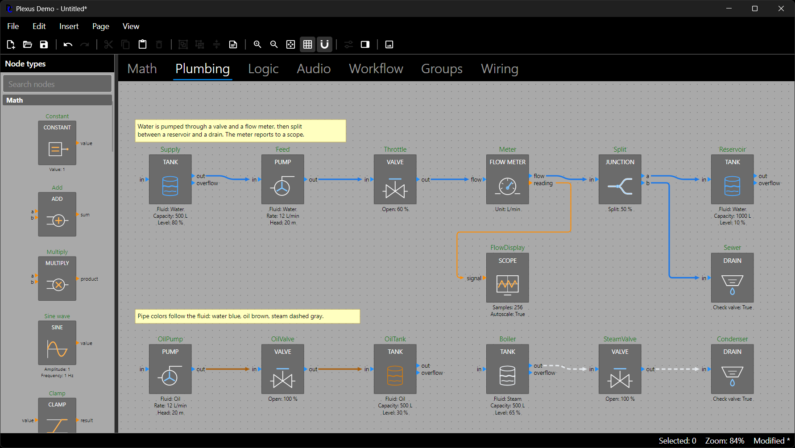
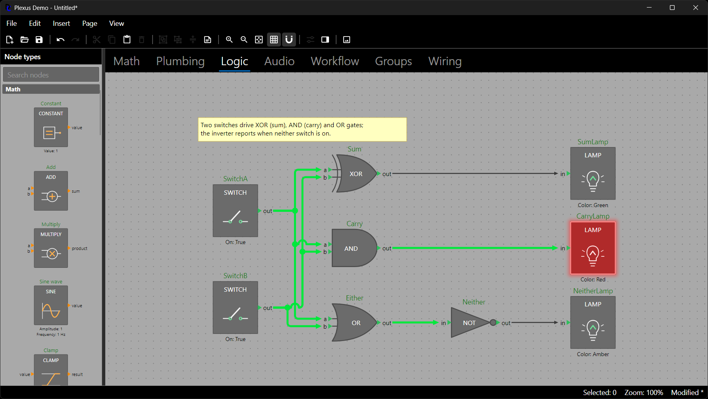

# Appearance: Themes and Styling

Appearance is configuration, not content: it is separate from the model, it is not undoable and it is not saved in
files. Plexus has three layers. The **theme** gives every diagram element its look and geometry. **Stylers** override
the look of individual wires and nodes from their data, every time the scene is built, so a diagram can show live
state. A **custom node visual** replaces how a node type is drawn (see *Extending Plexus*). Everything here is shared
by the headless renderer and the Avalonia editor, so both draw the same picture.

## The Theme

`DiagramTheme` is an immutable record that carries every metric, color and font that the model, the wire router and
both painters share. Derive a new theme from `DiagramTheme.Classic` with `with`:

```csharp
using DemaConsulting.Plexus.Scene;

diagram.Theme = DiagramTheme.Classic with
{
    NodeFill = Color.Parse("#335577"),
    WireColor = Color.Parse("#E0E0E0"),
    CanvasBackground = Color.Parse("#202020"),
    GridSize = 20,
};
```

A complete dark theme needs the text colors as well, since the classic theme draws black text on a gray canvas:

```csharp
diagram.Theme = DiagramTheme.Classic with
{
    CanvasBackground = Color.Parse("#1E1E1E"),
    GridDotColor = Color.Parse("#444444"),
    NodeFill = Color.Parse("#3C3C3C"),
    NodeBorder = Color.Parse("#707070"),
    NodeNameText = Color.Parse("#7FD47F"),
    PortLabelText = Color.Parse("#DDDDDD"),
    SummaryText = Color.Parse("#DDDDDD"),
    WireColor = Color.Parse("#E0E0E0"),
};
```

The theme has members for the node box (fill, border, corner radius, header height and text), names, summaries and
port labels (colors, font sizes), ports (pitch, triangle size, hit radius), wires (color, thickness, corner radius,
stub length, arrowheads), groups (frame, title bar, padding, collapsed size), annotations, selection and hover colors
and the grid (size and dot color). Because the metrics are in the theme, the model and the router agree with the
painters about where ports and wires are. The grid size (`GridSize`, default 15) is also the step for snapping and
routing.

Where a different look is wanted only for display, override the theme without touching the diagram:

```csharp
Editor.DiagramTheme = DiagramTheme.Classic with { CanvasBackground = Color.Parse("#202020") };   // display only
byte[] printable = PlexusRenderer.RenderPng(page, new RenderOptions { Theme = DiagramTheme.Classic });
```

The editor's `DiagramTheme` property and `RenderOptions.Theme` replace the diagram's theme for painting. Keep such an
override to colors and fonts: metrics such as the port pitch also decide where wires are routed, and the router uses the
diagram's own theme.

### Port Alignment

Ports are centered vertically by default: the inputs on the left edge and the outputs on the right edge each form a
stack, one `PortPitch` apart, centered on the node box (a collapsed group's proxy ports follow the same rule), and a
node's default height grows so that the longer stack clears the header. A stack with an even number of ports straddles
the middle on half-grid positions, and the wire between two aligned nodes with equal port counts is exactly straight. To
start each stack just below the header instead, as in earlier versions:

```csharp
diagram.Theme = DiagramTheme.Classic with { PortAlignment = PortAlignment.Top };    // default: PortAlignment.Center
```

With `Top` the first port sits `FirstPortOffset` (default 0) below the header; with `Center`, `FirstPortOffset` is the
minimum clearance between the header and the topmost port that the default node height reserves.

### Wire Drawing Options

Several wire drawing behaviors are theme switches, all on by default. They change how routes are drawn, never the
stored routes or hit testing:

```csharp
diagram.Theme = DiagramTheme.Classic with
{
    WireCrossingJumps = true,         // a wire hops over a wire of a different net it crosses (WireJumpRadius)
    WireJunctionDots = true,          // a dot where wires of one net branch apart (WireJunctionRadius)
    WireSmoothSmallJogs = true,       // a step shorter than twice WireCornerRadius is drawn as one gentle S-curve
    GroupsAreObstacles = true,        // wires are routed around the frames of groups they do not belong to
};
```

These are explained with pictures in *Wires, Routing and Connection Rules*.

## Styling Wires

The theme gives every wire the same look. To color, thicken, dash or remove the arrowhead of individual wires, assign
`Diagram.WireStyler`: a function that receives each wire and returns a `WireStyle` (or `null` for the theme). Every
`WireStyle` member is optional (`Color`, `Thickness`, `Dash`, `Arrowhead`), and anything left unset comes from the
theme. The styler runs for each wire every time the scene is built, so the style follows whatever the wire connects:
its ports, their types, the connected nodes, node properties or any data of your own.

```csharp
diagram.WireStyler = WireStylers.ByPortType();           // each wire takes the color of its source port's type

diagram.WireStyler = wire => wire.Target.Node.Name == "Scope"        // or write your own
    ? new WireStyle { Color = Color.Parse("#E03030"), Thickness = 4, Arrowhead = false }
    : null;
```

`WireStylers` has ready-made building blocks and `Combine`, which applies stylers in order so that later ones override
only the members they set. The demo composes three layers this way:

```csharp
diagram.WireStyler = WireStylers.Combine(
    WireStylers.ByPortType(),                                           // 1. color by port type
    WireStylers.BySourceNodeProperty("Enabled",                         // 2. dash wires leaving a disabled node
        enabled => enabled is false ? new WireStyle { Dash = [6, 4], Thickness = 1 } : null),
    WireStylers.When(w => w.Source.Node.Type.Key == "math.Scope", new WireStyle { Thickness = 3 }));    // 3. a rule
```



In the demo's plumbing sample the pipes take the color of the fluid in them: the `Fluid` property of the pump or tank
found by walking upstream from the wire's source, with steam also dashed. Changing the fluid of a pump recolors every
pipe after it, because the styler reads the model every time the scene is built.

### Expensive Styling: PerPage

A styler runs for every wire of every scene build. Work that is shared by all the wires of a page (a simulation, a
graph traversal) should not run once per wire. `WireStylers.PerPage` takes a factory that receives the page and returns
the styler for that page; the factory runs once per page and `Diagram.Version`, so there is no cache to write or
invalidate:

```csharp
diagram.WireStyler = WireStylers.Combine(
    WireStylers.ByPortType(),
    WireStylers.PerPage(p =>
    {
        var live = Simulate(p);                      // your computation: once per page and change, not once per wire
        return wire => live.TryGetValue(wire.Source, out var on)
            ? new WireStyle { Color = on ? Color.Parse("#00E83C") : Color.Parse("#3A3A3A"), Thickness = on ? 4 : 2 }
            : null;
    }));
```

The demo's logic sample does exactly this: its `LogicEvaluator` computes the true or false value of every logic port,
and the wires are bright green and thick while they carry true, dark gray while they carry false. Toggling a switch is
an ordinary property edit that advances `Diagram.Version`, so the next scene build recomputes everything.



## Styling Nodes

`Diagram.NodeStyler` is the node equivalent: a function that receives each visible node and returns a `NodeStyle` (or
`null`). Every member is optional (`Fill`, `Border`, `BorderThickness`, `HeaderText`, `IconTint`, `Glow`, `Opacity`) and
anything left unset comes from the theme and the node type. A node can show state: a lit lamp, a disabled node, the
fluid a tank holds.

```csharp
diagram.NodeStyler = NodeStylers.Combine(
    NodeStylers.ByProperty("Enabled", enabled => enabled is false ? new NodeStyle { Opacity = 0.45 } : null),
    NodeStylers.When(node => node.Name == "Alarm", new NodeStyle
    {
        Fill = Color.Parse("#B02A2A"),
        Border = Color.Parse("#FF8A8A"),
        Glow = Color.Parse("#FF3030"),
        IconTint = Color.Parse("#FFE3E3"),
    }));
```

- `IconTint` paints the icon as a silhouette: every pixel the icon paints takes the tint color and the icon's own
  transparency decides how much shows. The PNG renderer and the Avalonia editor do this identically.
- `Glow` is a soft halo of a few translucent rings that fade outward from the box, about 12 diagram units wide; the
  alpha of the color scales its strength. `Opacity` (0 to 1) fades everything the standard visual draws for the node.
- `NodeStylers.ByProperty`, `When`, `Combine` and `PerPage` work like their `WireStylers` counterparts. The demo lights
  a lamp from the same per-page logic result its wires use, and tints a tank's icon by the fluid it holds.
- Selection and hover outlines are always drawn on top of a styled node. The node palette shows each type's default
  look and is not affected by a `NodeStyler`.

## Rules for Stylers

- Styling is configuration. It is not undoable and not saved in snapshots, so put the stylers in the `DiagramOptions`
  you pass to every diagram the host creates or loads (see *Configuration* in *Saving, Loading and the Clipboard*).
  Assigning a styler repaints editors.
- A styler reads the model and returns a style; it must not change the model. An exception thrown by a styler never
  breaks rendering: the affected wire or node is drawn from the theme.
- If a styler reads state that lives outside the diagram (a simulation running elsewhere, a filter in the host's UI),
  call `diagram.RefreshAppearance()` after that state changes. It repaints without changing the model or adding an undo
  entry.
- `Diagram.Version` is also a cheap cache key for anything else you derive from a diagram.
- Dashes are cut by the scene and both painters use flat line caps, so the PNG renderer and the Avalonia editor draw the
  same dash pattern.
- Invalid style values (a non-positive thickness, an opacity outside 0 to 1) throw when the style is created.
