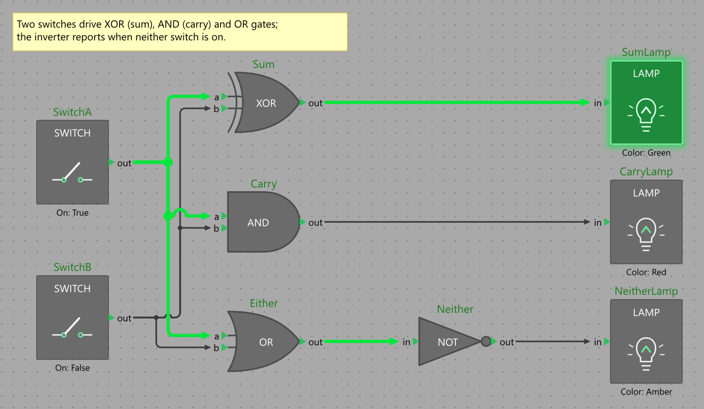

# Testing and Automating

A host application built on Plexus can be tested at three levels, from cheap to realistic: the model without any UI, the
editor control in a headless Avalonia session, and the real application driven from outside. The demo uses all three,
and its last level, an automation endpoint plus a driver called the *Puppet*, is a pattern worth copying.

## Testing the Model

The model is plain objects with no UI dependency, so most of an application's rules are tested without Avalonia: build
a diagram, perform the operations a user would, and assert. Undo is part of the model, so a test can check that an
operation is reversible in one line.

```csharp
using Xunit;

var testDiagram = new Diagram(types);
var testPage = testDiagram.Pages.Add("Main");
var one = testPage.AddNode("math.Constant", 0, 0, "One");
var adder = testPage.AddNode("math.Add", 200, 0, "Adder");

var connection = testPage.Connect("One.value", "Adder.a");
Assert.Single(adder.Input("a").Wires);

testDiagram.History.Undo();
Assert.Empty(testPage.Wires);
```

Use `History.Suspend()` to set up a fixture without filling the undo stack, `Diagram.ToJson()` and `FromJson()` to test
a file round trip (compare the JSON of the loaded diagram with the original), and a second registry that lacks a node
type to test the clipboard failure path, exactly as the demo's `--types basic` does. The connection rules, the rename
hook and the stylers are plain functions of the model, so they are unit tested the same way: build a diagram, call
`CanConnect`, `TryRename` or the styler, and check the result.

## Testing Rendering

The headless renderer is deterministic for a given theme, font and scale, so a rendering test is two lines:

```csharp
byte[] png = PlexusRenderer.RenderPng(page, new RenderOptions { Scale = 1, ShowGrid = false });
File.WriteAllBytes("actual.png", png);                       // compare with a stored image in your test framework
```

Rendering exercises everything a painter does with your node types: icons, custom visuals, stylers, themes and routing.
Fonts are the usual source of differences between machines; set `DiagramTheme.FontFamily` to a font bundled with the
test project, or compare with a tolerance. The demo's command-line renderer (see *Rendering to PNG*) renders any sample
page, which makes it handy for reviewing a change to wire drawing by eye.

## Testing the Editor Headlessly

`DiagramEditor` runs in Avalonia's headless platform, so tests can create an editor, call its methods and even send it
pointer and keyboard input without a display. Add the packages `Avalonia.Headless` and `Avalonia.Skia` to the test
project (Skia keeps text measurement real) and start one headless session for the whole test run, because Avalonia
allows only one application per process:

```csharp
using Avalonia;
using Avalonia.Controls;
using Avalonia.Headless;
using Avalonia.Themes.Fluent;
using DemaConsulting.Plexus.Avalonia;

public sealed class TestApp : Application
{
    public override void Initialize() => Styles.Add(new FluentTheme());     // real control templates, so text input works
}

public static class TestAppBuilder
{
    public static AppBuilder BuildAvaloniaApp() => AppBuilder.Configure<TestApp>()
        .UseSkia()
        .UseHeadless(new AvaloniaHeadlessPlatformOptions { UseHeadlessDrawing = false });
}

public static class Ui
{
    private static readonly HeadlessUnitTestSession Session = HeadlessUnitTestSession.StartNew(typeof(TestAppBuilder));

    public static Task Run(Action body) => Session.Dispatch(body, CancellationToken.None);    // runs on the UI thread
}
```

A test body then creates the editor in a window and uses the public API, which is enough for most host logic (the
editor's own gestures are covered by Plexus's tests). `InMemoryClipboard` is the class of *Extending Plexus*:

```csharp
await Ui.Run(() =>
{
    var editor = new DiagramEditor { Page = page, Clipboard = new InMemoryClipboard() };   // never touch the real clipboard
    new Window { Width = 800, Height = 600, Content = editor }.Show();

    editor.Select(sum);
    editor.DeleteSelection();
    Assert.DoesNotContain(page.Nodes, n => n.Name == "Sum");
    Assert.True(editor.Undo());                          // one undo entry brings the node back
});
```

To test a gesture itself, send the pointer input a user would. The editor can tell you where things are on screen, so
the test needs no pixel constants:

```csharp
using Avalonia;
using Avalonia.Headless;
using Avalonia.Input;

var window = TopLevel.GetTopLevel(Editor)!;
var from = Editor.GetPortScreenPosition(a.Output("value"));
var to = Editor.GetPortScreenPosition(scope.Input("signal"));
window.MouseDown(from, MouseButton.Left);
window.MouseMove(new Point((from.X + to.X) / 2, (from.Y + to.Y) / 2));       // moves past the drag threshold
window.MouseMove(to);
window.MouseUp(to, MouseButton.Left);                                          // a wire from A to Scope
```

`GetPortScreenPosition(port)` and `GetElementScreenBounds(element)` give positions relative to the control,
`DiagramToScreen` and `ScreenToDiagram` convert points, and `HitTest(point)` reports what lies under a point. Give the
test window a known size and leave the view at zoom 1 with no offset, and diagram coordinates equal screen coordinates.

## Driving the Real Application

The headless tests cannot show how the real application behaves with the operating system's clipboard, real windows,
dialogs, menus and mouse. The demo is built to be driven from outside, with a pattern that any host can copy; none of it
is part of the shipped packages, and none of it belongs in a product.

**One controller.** Every command is implemented once, in a session class that owns the current diagram, its file and
its dirty state (the demo's `DemoSession`). The menus and the automation endpoint are thin layers over it, so a command
behaves identically however it is triggered. Because the model is single-threaded, the controller is used from the UI
thread only.

**An automation endpoint.** With `--automation <name>` the demo serves a named pipe `plexus-demo-<name>` (current user
only, local machine only, off by default). The protocol is newline-delimited JSON, one request line and one reply line:
`{"cmd":"add-node","type":"Mixer","x":60,"y":60}` is answered by `{"ok":true,"result":{...}}`. Each request hops to
the UI thread (`Dispatcher.UIThread.InvokeAsync`) and calls the controller. The commands query the model (`info`,
`list-nodes`, `list-wires`), change it (`add-node`, `connect`, `set-property`, `group`, `move-to-page`, `undo`, `paste`
and others) and report **geometry**: where a node, a port or the editor is on the physical screen, which is how an
external tool turns a diagram position into a real mouse position.

```csharp
var bounds = Editor.GetElementScreenBounds(sum);                              // relative to the editor control
PixelPoint onScreen = Editor.PointToScreen(bounds.Center);                    // physical pixels, ready for real input
```

**Stable AutomationIds.** Every interactive control carries an AutomationId following a scheme (`Area_Item[_Detail]`,
for example `Menu_Edit_Undo`, `PropertyGridDialog`, `Status_Text`). The editor and the palette have ids of their own
(`DiagramEditor`, `NodePalette`, `NodePalette_Filter` and one per node type from `NodePalette.GetAutomationId`), so a
driver never relies on captions or the position in the visual tree.

**A stateless driver.** The Puppet (`tools/DemaConsulting.Plexus.Puppet`) is a command-line tool in which every command
is a fresh process that finds the demo by its alias, does one thing, prints plain text and exits with a documented
code. It uses UI Automation for menus, dialogs, keyboard and screenshots, the pipe for model queries and geometry, and
real operating-system mouse input for the canvas gestures:

```powershell
$puppet = '.\tools\DemaConsulting.Plexus.Puppet\bin\Release\net10.0-windows\plexus-puppet.exe'
& $puppet launch --instance full --sample audio       # the full node type set
& $puppet launch --instance basic --types basic       # only the math types
& $puppet click-node Mix --instance full              # a real mouse click on the node
& $puppet key Ctrl+C --instance full                  # a real key press: copy through the system clipboard
& $puppet pipe paste --instance basic                 # paste in the second instance
& $puppet read Status_Text --instance basic           # Paste failed: this application does not know the node type(s) ...
& $puppet shot C:\temp\basic.png --instance basic     # a screenshot of the window
& $puppet hover-node Shape --shot C:\temp\tip.png --instance full   # capture a node's tooltip
```

Gestures are expressed in diagram units (`drag-node Tone 0 120`, `drag-connect Tone.out Mix.in`, `drag-palette Mixer
300 200`, `wheel 3 --ctrl`, `hover-port Tone.out`), so they do not depend on zoom, window position or monitor scaling.
Hover commands park the cursor on empty canvas first and then rest on the target long enough for its tooltip to open,
so a `--shot` screen copy shows the tooltip a user would see. Before any real input
the Puppet checks that the window at the target pixel belongs to the instance and refuses otherwise, so it cannot click
into another application. The commands change the model directly (the pipe) or through the real editor input (the
mouse and keys): use the pipe to set up and to verify, and the mouse and keys to test the editor itself.



## Practical Advice

- Keep logic in the model and the controller and keep the window thin, so that the interesting behavior is testable at
  the first level.
- Test with two registries to cover the paste failure path, and give the editor an in-memory `IDiagramClipboard` in
  headless tests.
- Prefer the editor's methods (`Select`, `DeleteSelection`, `AddNodeAtCenter`, `BeginRename`) over synthesized input
  unless the gesture itself is under test; use `GetPortScreenPosition` and `GetElementScreenBounds` when it is.
- Drive the palette from code (`Select`, `Activate`, `VisibleTypes`) instead of dragging with the mouse, and use
  `NodePalette.GetAutomationId` in UI automation.
- Never ship an automation endpoint: the demo's is for development, restricted to the current user and off by default.
