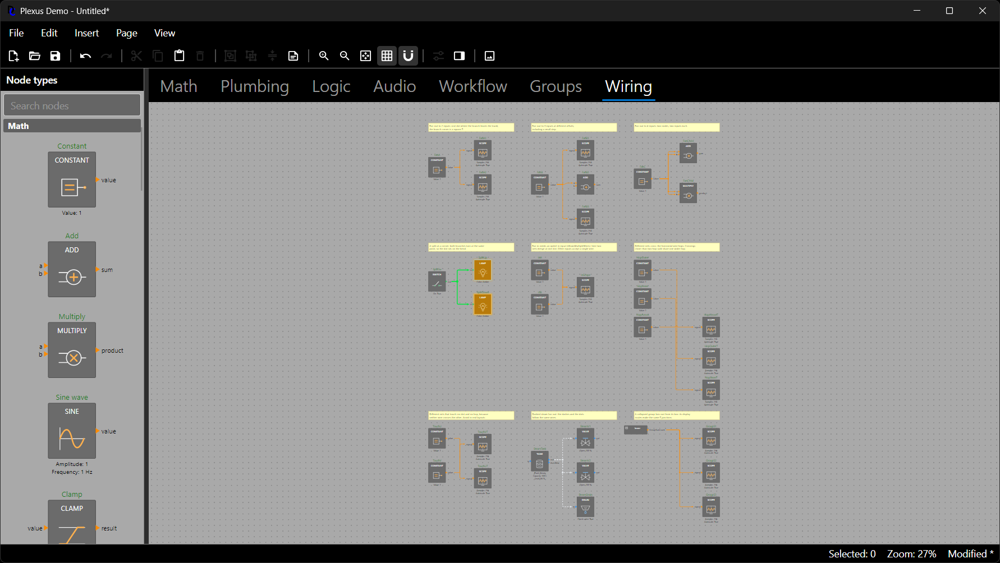
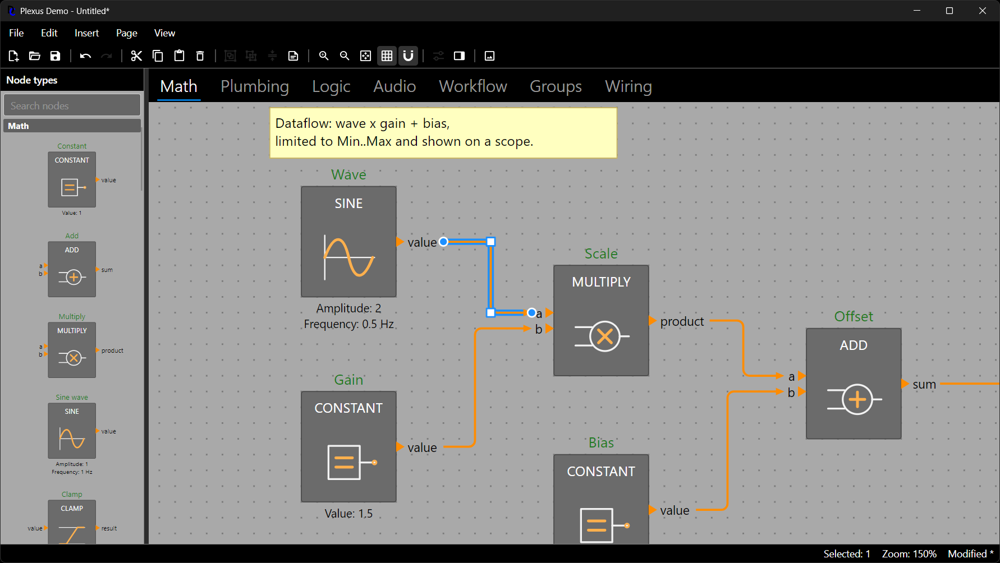

# Wires, Routing and Connection Rules

A wire connects an output port to an input port. Plexus decides which connections are legal (connection rules),
computes the path of every wire (routing) and draws wires so that related wires read as one signal and unrelated wires
read as passing each other (nets, junction dots and crossing hops). Users can reshape wires by hand. This chapter covers
the three in turn.



## Connection Rules

Plexus always enforces the structure of a wire: it runs from an output to an input, both ports are on the page, the
nodes differ (a node cannot feed itself, so no custom rule is needed for that) and the same two ports are not connected
twice. On top of that a `ConnectionValidator` decides. It is also consulted live while the user drags a wire, and the
editor shows the reason when a drop target is refused. A validator is always called as `(output, input)`, whichever
order the caller used.

By default a diagram uses `ConnectionRules.Default`: an output may feed any number of inputs (fan-out), but an input
accepts **one wire**. A second wire into an occupied input is refused with
`Input 'Mixer1.in' already has a wire; it does not accept more than one.` (`DiagramPage.CanConnect` reports it and
`DiagramPage.Connect` throws it). Port types are **not** compared by default: a number output can feed an audio input.

Hosts add domain policy by composing rules. Keep `ConnectionRules.Default` in the combination so that the single-wire
input policy stays in force:

```csharp
// The demo's policy: ports must have the same type (a number cannot drive an audio input)
diagram.ConnectionRules = ConnectionRules.All(ConnectionRules.Default, ConnectionRules.SameType);

// Your own rule: a ConnectionValidator receives (output, input) and returns Allowed or Denied(reason)
diagram.ConnectionRules = ConnectionRules.All(
    ConnectionRules.Default,
    ConnectionRules.SameType,
    (output, input) => output.Wires.Count >= 3
        ? ConnectionCheck.Denied($"{output} already feeds three inputs.")
        : ConnectionCheck.Allowed);
```

`ConnectionRules.SingleInputWire` is the same single-wire rule under a name for explicit compositions. A host that
assigns a rule built **without** `Default` or `SingleInputWire` (for example `ConnectionRules.SameType` alone, or its own
delegate) takes over the whole decision, so an input then accepts several wires wherever its rule allows it: that is how
a host allows fan-in everywhere. `Diagram.ConnectionRules` (the property) and `ConnectionRules` (the static class of
building blocks) share a name on purpose.

Rules are consulted wherever a wire is created or moved: `Connect`, `CanConnect`, `Reconnect`, `CanReconnect`, the
editor's drag gestures, paste and duplicate (a wire the rules refuse is skipped and a warning names the reason).
Loading a snapshot does not run the rules: a saved diagram is restored as written.

### Fan-in

Some inputs legitimately merge wires, such as the join of a workflow or a scope that overlays several traces. Declare
that on the port definition:

```csharp
types.Add(new NodeType("flow.Join")
{
    Inputs = { new PortDefinition("in", "flow") { AllowsMultipleWires = true } },
    Outputs = { new PortDefinition("out", "flow") },
});
```

`PortDefinition.AllowsMultipleWires` (false by default) is read by `ConnectionRules.Default` and `SingleInputWire`;
`Port.AllowsMultipleWires` exposes it on a node's port (an output always reports true, since outputs fan out freely).
In the demo every workflow step input and the Scope input opt in.

## Nets and How Wires Are Drawn

Wires that start at the same output port form a **net**: they carry the same signal. The default router keeps different
nets on separate tracks (it does not run a new wire on top of another net's wire) and lets the wires of one net share a
trunk. A few drawing rules make the result readable; all of them are theme switches (see *Wire Drawing Options* in
*Appearance: Themes and Styling*) and none of them change the stored routes:

- A small dot marks every point where wires of one net branch apart (`WireJunctionDots`, `WireJunctionRadius`), and the
  branching corner is drawn square so that the dot sits on a crisp "T"; other corners stay rounded. Wires of different
  nets never get a dot, even where they cross or touch. Wires that merge into an input with fan-in are one net with the
  wires of their sources, so the merge point gets a dot too. Wires drawn to a collapsed group keep clear of other nets
  the same way and get the same dots.
- Where a horizontal wire crosses a vertical wire of a **different** net, the horizontal wire draws a small
  semicircular hop (`WireCrossingJumps`, `WireJumpRadius`) so that the two read as passing each other, not connected.
  Crossings closer than two hop radii share one wider hop; a crossing at a bend or an end, on a corner curve, under an
  arrowhead or at a junction gets none. Hops are drawing only: the stored route and hit testing stay straight.
- A small step in a wire, shorter than twice `WireCornerRadius`, is drawn as one gentle S-curve instead of two tight
  corners (`WireSmoothSmallJogs`).
- Wires avoid the frames of groups they do not belong to (`GroupsAreObstacles`) and may cross the frames of the groups
  they start or end in.

Stored routes are tidied automatically: bends that no longer bend and zero-length segments are removed whenever a
route is set, without changing what is drawn. The *wiring* sample of the demo is a one-page audit of all of these
cases; it is the page to look at after any change to wire drawing.

## Routing

Routes are computed by an `IWireRouter` when a wire is created or reconnected, when one of its end nodes moves, and by
`page.RerouteAll()` or `wire.Reroute()`. Wires among nodes that move by the same offset are translated instead of
re-routed. The default router is the obstacle-avoiding `OrthogonalRouter`, which can be tuned; `SimpleRouter` is a
cheap obstacle-ignoring Z-shaped elbow.

```csharp
using DemaConsulting.Plexus.Routing;

diagram.Router = new OrthogonalRouter { BendPenalty = 40 };   // fewer bends, longer detours (OverlapPenalty = 0: overlap)
diagram.Router = new SimpleRouter();                           // wires connected or moved from now on use it
page.RerouteAll();                                             // route the wires that already exist again
```

Routing happens when a wire is routed, not continuously: moving a group does not re-route unrelated wires, so call
`RerouteAll()` afterwards when they should avoid its new position. Display routes of wires attached to a collapsed group
follow the same rules.

### A Custom Router

A router receives a `RouteRequest` (the start and end anchors, the sides the wire leaves and enters through, the
obstacle boxes, the grid size and the segments of the wires already routed, tagged with their net) and returns the
interior bend points, without the end points. Routers must be deterministic and must not touch the model. A router
needs no more than to return the bends; an empty list is a straight line, and the result is normalized afterwards:
bends on a straight run and zero-length segments are removed.

```csharp
public sealed class MidpointRouter : IWireRouter
{
    public IReadOnlyList<Point> Route(RouteRequest request)
    {
        var x = (request.Start.X + request.End.X) / 2;
        return [new Point(x, request.Start.Y), new Point(x, request.End.Y)];     // one vertical run in the middle
    }
}

diagram.Router = new MidpointRouter();
page.RerouteAll();
```

`request.Obstacles` are the node boxes inflated by the theme's margin (they include the wire's own end nodes) and
`request.ExistingSegments` are the other wires. `OrthogonalRouter` uses them to avoid obstacles and other nets; a custom
router may ignore them, as this one does.

## Editing Wires

Click a wire to select it. A selected wire shows small handles: a square at every bend and a circle at both ends. Every
edit below is orthogonal, snaps to the grid (`SnapToGrid`), is one undo step and can be cancelled with Escape while the
mouse button is down.



- **Drag a bend handle** to move the corner; the two segments that meet there follow (one takes the new Y, the other
  the new X).
- **Drag a segment** to slide it sideways. This works for the short stub next to a port too: the port stays where it
  is and a small jog is inserted beside it.
- **Double-click a segment** to add a jog (a small bump of four bends) at that point; the new middle piece is a normal
  segment that can be dragged. Dragging it back in line with its neighbors removes the bump again, because bends that
  no longer bend are merged automatically.
- **Drag an end handle** onto another port to reconnect the wire there. While dragging, a preview wire follows the
  pointer and turns green over a port the connection rules allow and red (with the reason) over one they reject;
  releasing on an allowed port reconnects (the wire keeps its id and is re-routed), releasing anywhere else cancels.
  The source end takes outputs and the target end takes inputs.

While a wire is selected its end handles sit on the ports it is attached to, so a press there drags the wire's end;
click the canvas first to start a new connection from such a port. A manually shaped wire keeps its shape until one of
its end nodes moves or it is re-routed.

The same operations are available without a user interface:

```csharp
wire.AddJog(segmentIndex: 1, near: new Point(150, 80));     // a draggable bump on segment 1 (see HitResult.SegmentIndex)
wire.SetRoute([new Point(150, 30), new Point(150, 90)]);    // replace the bends; collinear bends are merged
ConnectionCheck verdict = page.CanReconnect(wire, newSource: null, newTarget: scope.Input("signal"));
wire.Reconnect(newSource: null, newTarget: scope.Input("signal"));   // same wire and id, re-routed, one undo step
wire.Reroute();                                              // discard manual edits
```

`RouteEditor` (move a segment or bend, insert a jog) and `RouteCleaner` (merge collinear bends) in
`DemaConsulting.Plexus.Routing` are the pure functions behind these edits. Hit testing reports the handles as
`HitKind.WireBend` (with `BendIndex`), `HitKind.WireSourceHandle` and `HitKind.WireTargetHandle`, and a hit on the wire
itself carries the `SegmentIndex` (see *Extending Plexus*).
